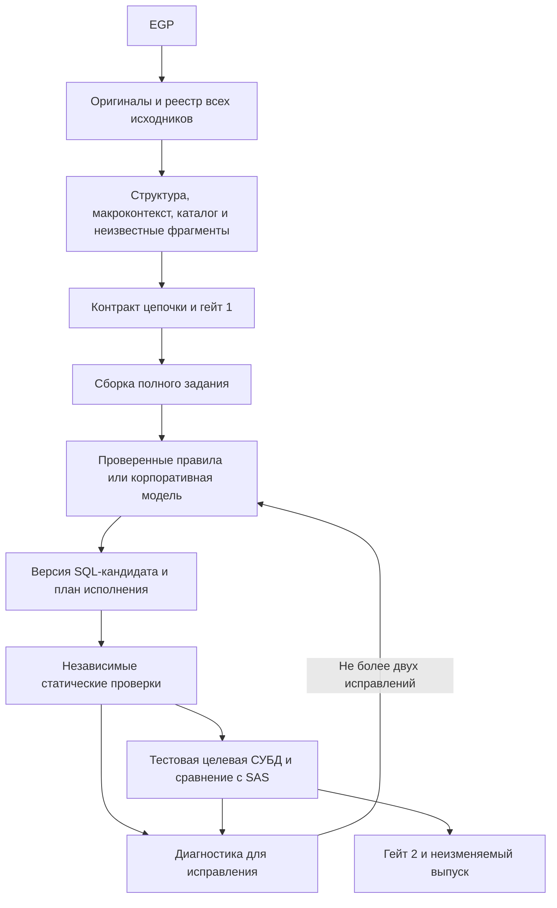

# Будущая архитектура: корпоративная модель и проверяемая миграция

Дата: 28 октября 2026 года. Статус: уточнённое предложение, не реализованное подключение. Основа - прежний план прямого корпоративного API, приложенное пользователем описание контроля галлюцинаций и новые локальные эксперименты с OSS. Модель, SAS и целевые СУБД в этой работе не вызывались.

Дополнение от 31 октября: [панель назначения источников и детерминированный контракт](SOURCE_BINDINGS_UX_SPEC.md). Новое расположение задаёт пользователь перед гейтом 1. Решение хранится в проекте, входит в ревизии и применяется backend; модель не выбирает и не подтверждает назначения. Подготовлен отдельный интерактивный макет, интеграция с backend пока не выполнена.

## 1. Какие записи восстановлены

Актуальная последовательность реализации и разбор рисков: [ревью от 31 октября](NEW_ARCHITECTURE_DEVELOPMENT_REVIEW_20261031.md). Это план, не отчёт о подключении API или завершении нового ядра.

| Запись | Прежнее решение | Что сохраняем |
|---|---|---|
| [Обзор AI-driven архитектуры от 20 октября](AI_DRIVEN_ARCHITECTURE_REVIEW_20261020.md) | Основной путь - Python вызывает корпоративный OpenAI-compatible endpoint. Langflow необязателен | Один пользовательский интерфейс и прямой корпоративный API |
| [План P0-P9](API_SERVICE_IMPLEMENTATION_PLAN.md) | Новое ядро рядом с текущим продуктом; сохранить импорт, интерфейс, полезные правила | Не добавлять модель внутрь нынешней цепочки обработки `public_source` |
| [Шесть вариантов процесса](experiments/architecture_variants/README.md) | Правила, прямой API и Langflow возвращают кандидатов одного контракта | Генератор можно заменить без изменения гейтов и критериев |
| [Эксперимент качества](experiments/quality_first/results/report.md) | Синтаксический успех не означает правильные данные | Проверять весь результат цепочки, включая значения и кратность |
| [История проекта](PROJECT_CONTEXT_AND_EXPERIMENT_HISTORY.md) | Сохранность исходника, полноценная миграция, Greenplum первым, два гейта | Эти требования остаются определяющими |
| [Повторная проверка OSS](experiments/oss_followup/README.md) | Официальное ядро SAS пригодно для дальнейшего испытания структуры; sas-lexer сохраняет токены 48 программ | Использовать готовый разбор через заменяемый адаптер, не считать его семантическим доказательством |

Приложенный текст подтверждает тот же принцип: модель предлагает SQL, приложение проверяет, человек утверждает конкретную ревизию. В прежнем плане уже были максимум две дополнительные попытки исправления, запрет на изменение эталонов моделью и исполнение принятого ETL без повторного обращения к модели.

Известно со слов пользователя: корпоративный OpenAI-compatible API доступен, используются локальные открытые модели, ранее упоминался Qwen. Точный model ID, версия сервера, контекстное окно и возможности endpoint пока не проверены. Отдельное подключение Kimi не планируем. Публичный запасной endpoint не нужен. Наличие Langflow не требует переносить туда приложение.

## 2. Что подтверждено в текущей реализации

Повторно просмотрен код, без нового прогона всего приложения:

- `app/core.py: make_block` вычисляет `clean = public_source(source)`, затем передаёт `clean` в `semantic_snapshot` и `sql_candidates`.
- `public_source` при лексической ошибке оставляет только проверенный префикс для сохранения; соединения и inline-данные обрабатываются как проекция для отображения. Она не является полноценным исходником миграции.
- `app/server.py: model_config` возвращает `available: False`. Подтверждённого живого корпоративного подключения нет.
- Эксперимент `quality_first` содержит снимки исходников и привязанные к заданиям кандидаты, но его проверка исполнения ограничена SQLite-прокси и синтетическими примерами.
- В четырёх EGP учтено 49 программных узлов, доступны 48 исходников; одна внешняя программа отсутствует. Этот факт нельзя исправить модельным предположением.

Следствие: начать с нового источника истины и отдельного процесса миграции. Замена генератора при сохранении нынешнего обрезанного входа не решит проблему.

## 3. Уточнённое решение

Сохраняем Python/FastAPI, существующий интерфейс и полезные правила. Новое ядро готовим изолированно, как предусмотрено P0-P9. Пользователь загружает EGP, видит восстановленный сценарий, согласует смысл и затем проверенный результат. Внутренние словари, JSON и запросы модели не становятся обязательными действиями пользователя.

Стрелка к сравнению обозначает целевой процесс. Пока нет стенда и эталонов, она заканчивается статусом «проверка недоступна», а не автоматическим допуском к финальному выпуску.

Четыре уточнения к прежнему плану:

1. Полная семантическая IR всего SAS не является предварительным условием обращения к модели. Неразобранный узел хранит исходный текст, диапазон, окружение и неизвестные условия. После генерации он не становится проверенным только по заявлению модели.
2. Готовый SAS-разбор применяется для структуры и поиска контекста. Извлечение исходников, модельное объяснение и подтверждение смысла остаются отдельными результатами.
3. Единица генерации - целый шаг или связанная группа с определёнными входами и выходами. Нельзя собирать один DATA STEP из независимо переведённых строк, если они меняют общее состояние.
4. У проверок есть отдельные статусы и основания. Один зелёный «процент качества» не заменяет данные о полноте, исполнении и сравнении.

## 4. Модули и их ответственность

Это проект интерфейсов, а не утверждение о наличии готовых модулей. Небольшое число модулей скрывает детали сторонних библиотек и транспорта.

| Модуль | Интерфейс | Ответственность и поведение при проблеме |
|---|---|---|
| `sources` | `ingest(egp) -> SourceSnapshot` | Оригинальные байты, декодирование, принадлежность проекту и хеши. Не удаляет хвост при ошибке разбора |
| `context` | `prepare(snapshot, scenario, metadata) -> MigrationTask` | Структура, исходные диапазоны, определения макросов, версии таблиц, контракт и недостающие сведения |
| `generation` | `propose(task, diagnostics?) -> Candidate` | Правила либо модель, структурированный результат, происхождение предложения. Не выполняет SQL и не утверждает результат |
| `verification` | `verify(task, candidate, fixtures) -> EvidenceSet` | Полнота пакета, допустимые объекты, целевое исполнение и сравнение. Отсутствие данных для проверки возвращает явно |
| `workflow` | `apply(command, expected_revision) -> Revision / Job` | Два гейта, фоновые задания, ограниченные исправления, отмена, фиксация и экспорт |
| `infrastructure` | Реализации хранения, транспорта и целевого исполнения | SQLite/файлы, HTTP-клиент корпоративной модели, драйвер выбранной СУБД; конфигурация внедряется в модули |

Сторонний парсер меняется внутри `context`, а поставщик SQL - внутри `generation`. UI не знает, какая библиотека нашла блок и получен ли кандидат через правило или модель. UI знает происхождение результата, статус проверок и нерешённые вопросы.

## 5. Как используем найденный OSS

| Источник | Место в архитектуре | Ограничение |
|---|---|---|
| Официальное языковое ядро SAS | Предварительное выделение DATA/PROC/макросов и навигация | Редакторские секции не являются полноценной семантической IR. Нужен проверенный адаптер и сохранение текста вне секций |
| Официальные JSON-справочники SAS | Каталог известных функций, форматов, информатов и операторов | Известное имя не означает существующий правильный SQL-перевод |
| sas-lexer | Изолированный независимый контроль лексического покрытия | Пока не постоянная зависимость: AGPL требует отдельного решения по условиям использования |
| SparkShift | Изучение конкретных правил и небольших проверочных случаев | PySpark-генератор напрямую не переносим; авторские ожидаемые результаты не считаем SAS-эталоном |
| SQLGlot / дополнительный SQL-парсер | Проверка и анализ структуры SQL | Не подтверждают значения и не заменяют исполнение точной версии Greenplum |
| pyegp-parser | Независимая сверка инвентаря при разработке | Не требуется второй обязательный импортный путь для пользователя |

Официальный адаптер можно поставлять как собранный локальный Node-процесс, вызываемый Python. Развёртывание VS Code или подключение SAS для него не требуется. Это предложение упаковки: текущая сборка экспериментальная, ещё не часть backend.

Нормализуем координаты в одном месте: Node использует UTF-16, Python - индексы Unicode-символов, архив хранит байты. `SourceSpan` должен однозначно ссылаться на конкретный исходник, а преобразование координат проверяться. Иначе визуально правильная подсветка может указывать на неверный фрагмент задания.

В эксперименте исправлено завершение PROC SQL на RUN в отдельной копии официального ядра. Девять проверок границ прошли; это основание продолжить испытания, не основание объявить весь SAS разобранным.

## 6. Оригиналы, значения и контекст модели

У одного исходника три разных представления:

1. **Оригинал.** Неизменяемый закрытый артефакт с байтами, кодировкой и хешем; хранение вне репозитория и синхронизируемой рабочей папки. Анализ опирается на него.
2. **Представление для интерфейса.** Может скрывать реквизиты подключения и чувствительные данные, не заменяя оригинал.
3. **Задание модели.** Содержит разрешённый корпоративной политикой исходный контекст и явные ссылки на исключённые ресурсы. Если исключение делает перевод неоднозначным, это остаётся недостающим входом.

Значимые литералы нельзя заменять общими масками и ожидать эквивалентного SQL. Разрешённые значения передаются точно. Если их передавать нельзя, используем предусмотренный контрактом типизированный ресурс или параметр; восстановление выполняется локально и проверяется. Произвольный поиск/замена строк в ответе модели для восстановления значений не подходит.

Inline-таблицы остаются локальными ресурсами загрузки с известной схемой, числом строк и хешем. Они не исчезают вместе с DATALINES. Если модель не видит их содержимое, ей сообщаются реальные доступные сведения и ограничения задачи.

Обязательный контекст включает исходный шаг, используемые определения макросов и форматов, значения известных параметров и их происхождение, входные схемы, производителей/потребителей данных, версии перезаписываемых таблиц, выходной контракт и профиль целевой СУБД. Проверенные примеры из словаря дополняют этот контекст. Поиск похожего примера не заменяет отсутствующий внешний макрос.

Размер задания измеряется совместимым с фактической моделью способом, с резервом для ответа и служебного шаблона. Если точный токенизатор недоступен, оценка помечается приблизительной и используется запас; серверная ошибка лимита не приводит к тихому усечению. Слишком большой сценарий делится по согласованным зависимостям. Для каждого подраздела сохраняется общий контракт цепочки и точный состав полученного контекста. Свободный пересказ предыдущего чата не становится единственным источником фактов.

## 7. Макросы, IF и повторяемое исполнение

| Ситуация | Что фиксируем | Целевой способ реализации |
|---|---|---|
| Статический макрос, все параметры известны | Определение, вызов, область видимости, конкретные значения | Проверенное раскрытие либо генерация целой группы с теми же условиями |
| `%IF` зависит от параметра запуска | Обе допустимые ветви и момент выбора | Параметризованный пакет с явно поддержанной веткой исполнения |
| `SELECT INTO` / `SYMPUT` зависит от данных | Производитель значения, тип, область действия, момент доступности | Вычисление при целевом запуске; не константа, взятая из одного примера |
| Обычные последовательные IF и присваивания | Порядок чтения/записи переменных и выходов | Последовательные выражения/стадии; CASE подходит только при сохранении зависимостей |
| Динамические имена, вызовы и побочные эффекты | Допустимое множество действий или явная неизвестность | Ограниченный план исполнения либо блокировка до уточнения |
| LIBNAME | Предоставленное пользователем сопоставление | Самостоятельный resolver по-прежнему не добавляем |

Правило назначения сохраняется: без библиотеки или `WORK.` - временная таблица; явная схема назначения сохраняется. Нельзя незаметно заменить её общей staging-схемой ради удобства генератора.

Нужно различать **SQL для фиксированных условий запуска** и **повторяемый ETL с вычисляемыми условиями**. Для второго может потребоваться SQL вместе с декларативным планом для ограниченного runner. Это предлагаемый режим результата, который надо явно выбрать в контракте, а не скрытая замена обещанного SQL-файла. Произвольный сгенерированный Python не исполняем. Если выбран режим SQL-only и поведение невозможно выразить поддержанными средствами выбранной СУБД, показываем ограничение.

Принятый ETL использует фиксированный пакет. Модель требуется при разработке миграции и её изменении, а не при каждом ежедневном запуске.

## 8. Как именно используется корпоративный API

Вызов принадлежит backend. Ключ хранится в серверной конфигурации, не в браузере, EGP, контексте модели или журнале проекта. Никакого автоматического перехода на публичную модель при ошибке корпоративной не предусматривается.

Профиль подключения фиксирует base URL и путь вызова, model ID, авторизацию, таймауты, ограничения параллельности, лимиты контекста/ответа и проверенные возможности формата. Начальный кандидат - обычный запрос сообщений по поддерживаемому endpoint. OpenAI-compatible не считаем подтверждением JSON Schema, tool calling, Responses API, `/models` или конкретного поведения streaming. Доступность проверяется синтетическим запросом перед передачей корпоративного контекста.

**Вход модели:** `task_id`, `revision`, `task_hash`, целевой профиль, исходные фрагменты с диапазонами, макроконтекст, схемы, параметры, обязательные выходы, ограничения, применимые правила и при исправлении - предыдущий кандидат с диагностикой. Реестр обязательных выходов и проверочные ожидания принадлежат приложению/согласованному контракту.

**Выход модели:** структурированный `Candidate` с SQL-артефактами, порядком/разрешёнными шагами исполнения, заявленными входами/выходами, соответствиями исходнику и списком предположений/неизвестных. ID задания и хеш должны совпасть. Имена файлов и допустимые действия проверяет приложение. Свободное объяснение хранится для ревью, но не выполняется.

Если endpoint поддерживает строгую схему ответа, используем её; проверка на стороне Python остаётся обязательной. Если нет - требуем JSON и проверяем его самостоятельно. Невалидный или усечённый ответ сохраняется как незавершённая попытка. Нельзя извлечь из него первые SQL-фрагменты и показать готовый пакет.

Процесс генерации:

1. Приложение сохраняет задание, хеш контекста и версию стратегии; фоновый обработчик выполняет вызов вне транзакции проекта.
2. Принимает законченный ответ, проверяет структуру и актуальность ревизии, сохраняет кандидата без исполнения.
3. Проверяет кандидата. Ошибка становится конкретной диагностикой; сначала исправляем недостающий контекст, если причина в нём.
4. Разрешает максимум две дополнительные генерации для исправления. В пределах одного контракта критерии и эталоны не меняются.
5. Поздний ответ сохраняется в истории, но не применяется к изменённому проекту. Повтор сетевого запроса не означает повтор исполнения SQL.

Для старта - один генератор. Отдельная модельная рецензия возможна после измерения пользы, но не обязательна и не имеет права принимать результат. Низкая температура и фиксированный промпт не являются гарантией идентичного ответа; воспроизводимость обеспечивается сохранённым кандидатом и его доказательствами.

## 9. Проверки и два гейта

| Уровень | Что проверяет приложение | Чего этот уровень не доказывает |
|---|---|---|
| Сохранность | Все исходники и их диапазоны учтены, неизвестные области сохранены | Что смысл всех областей понят |
| Контракт кандидата | Ревизия, обязательные выходы, параметры, завершённость пакета, заявленные соответствия | Что заявления модели верны |
| Статика | SQL-разбор, разрешённые источники/назначения, поля при наличии каталога, зависимости и типы действий | Совпадение результатов обработки данных |
| Целевое исполнение | Весь пакет проходит на точной версии СУБД в тестовой области и нужной сессии | Эквивалентность исходному SAS |
| Сравнение | Все согласованные выходы совпадают с SAS на одинаковых входах/параметрах по утверждённым критериям | Отсутствие ошибок вне проверенного диапазона условий |

Подсчёт строк SQL, модулей или литералов полезен как сигнал. Он не должен требовать буквального равенства исходнику: одно действие может стать несколькими SQL-стадиями, литерал даты - типизированным выражением. Проверяем сохранение обязательств, происхождение преобразований и фактические значения. Даже полный source map не доказывает семантическое соответствие.

Гейт 1 фиксирует сценарий, условия запуска, результаты, предоставленные схемы/mapping, критические неизвестные и критерии проверки. Модель может предложить план, но не превратить неизвестное предположение в факт. Неполный контракт допускает исследовательский черновик, не полноценную приёмку.

Гейт 2 связывает конкретный SQL-пакет с хешами исходников, контракта, параметров, метаданных, целевого профиля, испытательных данных и результатов проверок. Изменения делают зависимые доказательства неактуальными. Отдельно доступны сохранение черновика и принятие проверенной миграции; это разные статусы.

Первый target - точная корпоративная версия Greenplum. PostgreSQL и ClickHouse получают отдельные профили и проверку. Успешный PG-разбор или SQLite-пример не переносит статус на Greenplum/ClickHouse. Динамические параметры вычисляются при исполнении; временным таблицам сохраняется требуемая сессия. Тестовое переназначение схем задаётся явным mapping, а не произвольной заменой строк SQL.

## 10. Как проверяем главную гипотезу

Сравниваем нынешний генератор и модельный путь на одном зафиксированном задании с одинаковым контекстом. Если текущий путь не способен потребить полный контекст, это отдельное ограничение baseline, а не повод отрезать вход у нового пути.

Первый реальный объём - цепочка 348 с `vstr`, её необходимыми производителями и потребителями. Сначала устанавливаем точный состав цепочки; не называем отдельный удачный SELECT миграцией всего сценария. Затем расширяем до всего выбранного сценария 348 и остальных файлов. Отсутствующий внешний исходник 541 остаётся блокировкой соответствующего объёма.

Измеряем:

- совпадение всех обязательных выходов с эталонами в первой попытке и после исправлений;
- пропущенные/добавленные действия, неверные значения и потерю дублей;
- ошибочное принятие известных неверных кандидатов и ошибочное отклонение корректных;
- долю полного согласованного объёма, оставшуюся непроверенной;
- время экспертных исправлений; затем стоимость и время генерации.

Примеры для настройки и контрольные сценарии разделяются. Исправляющий цикл не получает скрытые ожидаемые таблицы контрольного набора. После обнаруженного дефекта пример можно перенести в регрессию, но он перестаёт быть независимой закрытой оценкой. Рецензия модели и вручную рассчитанные синтетические ожидания маркируются отдельно от реальных результатов SAS.

Пока нет SAS-эталонов и тестового Greenplum, можно проверить сохранность, качество контекста, обмен с моделью, полноту пакета и синтетические случаи. Нельзя измерить итоговую эквивалентность ваших процессов или обещать процент автоматизации.

## 11. Что меняется в порядке P0-P9

Нумерация и общий план сохраняются. Новый список модулей вместо уже согласованного не вводим.

1. **P0-P1:** изолировать разработку, сохранить оригиналы и ресурсы, отделить UI-проекцию. Это обязательная первая доработка.
2. **P2:** подключить экспериментальный структурный адаптер, построить контекст и контракт цепочки. Не задерживать пилот до разработки универсального SAS-интерпретатора.
3. **P3:** реализовать проверки обмена, покрытия и пакета; подготовку целевого стенда и эталонов вести одновременно. Статус проверки без стенда остаётся явным.
4. **P4:** один корпоративный API-адаптер, сначала синтетический запрос, затем разрешённый полный корпоративный контекст; максимум две попытки исправления.
5. **P5:** исполнить и сравнить цепочку на Greenplum. Именно этот этап проверяет гипотезу о качестве миграции.
6. **P6-P9:** связать новый процесс с интерфейсом, принять согласованный корпус, закрепить выпуск и затем отдельно другие СУБД.

Для P4 понадобятся технические параметры существующего endpoint и модельный профиль; API-ключ в чат не нужен. Для P5 по-прежнему нужны версия/тестовая среда Greenplum, метаданные и эталоны SAS. Наличие корпоративного API закрывает вопрос транспорта к модели, но не эти условия приёмки.

Рекомендуемое направление остаётся прежним: наше приложение управляет миграцией, готовые библиотеки помогают читать SAS, корпоративная модель предлагает сложный SQL, независимые проверки определяют доказанный уровень готовности. Главная новая задача - обеспечить целостность входа до модели и не выдавать полноту редакторского разбора за правильность перевода.
