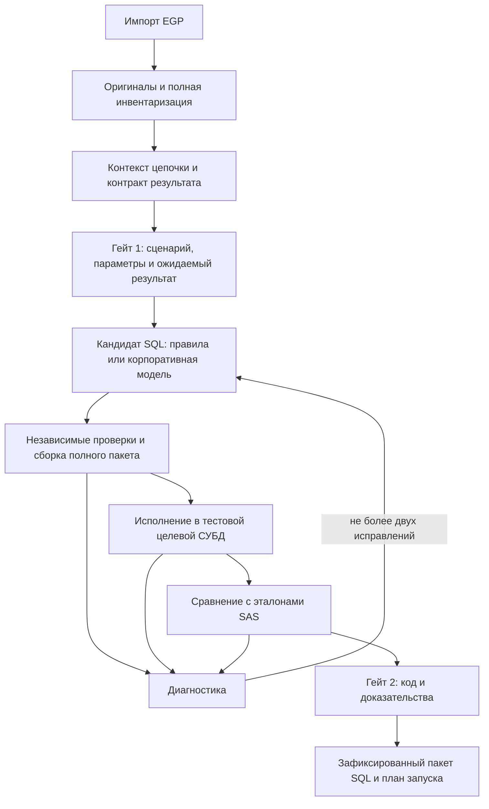

# План сборки сервиса: приложение + корпоративный API модели

Дата: 20 октября 2026 года. Статус: план реализации по выбранному пользователем направлению; этапы ниже ещё не выполнены.

Уточнение от 31 октября: [ревью плана разработки и проблемных мест](NEW_ARCHITECTURE_DEVELOPMENT_REVIEW_20261031.md). Сохраняет P0-P9, переносит назначения источников в ранний этап P2a, уточняет пилот, проверки и поставку EXE. Для порядка новой реализации использовать это уточнение.

Уточнение от 28 октября: [архитектура с учётом корпоративного API и проверки OSS](API_ARCHITECTURE_UPDATE_20261028.md). Сохраняет этапы P0-P9, уточняет роль структурного парсера, полного исходника, контекста модели и проверок. Это дополнение к плану, не отчёт о выполнении этапов.

## 1. Решение

**Собирать новое ядро параллельно, в отдельной рабочей копии и ветке, сохранив полезные части существующего приложения.** Переиспользовать интерфейс, извлечение EGP, проверенные правила и наработки экспериментального валидатора. Заново выделить хранение исходников, подготовку задания, управление кандидатами, проверками и согласованиями.

Это замена ядра внутри знакомого продукта. Переписывать интерфейс, менять Python/FastAPI/React или разворачивать Langflow для этого не требуется.

| Вариант | Что получаем | Основной недостаток | Решение |
|---|---|---|---|
| Добавлять API в действующий `core.py` | Быстрый первый вызов модели | Сохраняем связь компиляции с обработанным для отображения исходником и старые согласования черновика | Не использовать как основу сервиса |
| Написать весь продукт заново | Полная свобода | Повторно делаем импорт, интерфейс, редакторы и полезные правила; долго не проверяем главную гипотезу | Не выбирать |
| Новое ядро рядом, существующие компоненты через адаптеры | Изолированный эксперимент и ранняя проверка полного процесса | Нужны явные границы между старым и новым кодом | **Выбрать** |

Главная гипотеза: модель с полным контекстом лучше преобразует сложные SAS-фрагменты, а независимые проверки не пропускают неверный результат в принятый пакет. Её нужно проверить на реальной цепочке из файла 348 до расширения на весь корпус.

Галлюцинации нельзя устранить одним промптом, JSON Schema или повторной проверкой другой моделью. Архитектура ограничивает последствия ошибки, сохраняет доказательства и не выдаёт непроверенный результат за готовую миграцию.

## 2. Что установлено в текущем проекте

Проверены файлы приложения и состояние Git. Это не новый прогон тестов.

| Наблюдение | Следствие для реализации |
|---|---|
| `app/core.py`, `make_block`: `public_source(source)` передаётся в семантический разбор и генерацию | Нужен отдельный неизменяемый оригинал. Текст для экрана не должен быть входом компилятора |
| `app/core.py`, `transition`: план, компилятор правил, сборка и гейты связаны в одной функции | Выделить новый процесс миграции; старый генератор подключить только как источник кандидатов |
| Gate 1 сейчас имеет режим `draft_plan`, Gate 2 — `unverified_draft` | Переиспользовать идею привязки к ревизиям, но реализовать новые условия приёмки |
| `Store` находится в `app/server.py`; команда выполняет переход проекта внутри SQLite-транзакции | Вынести хранилище и задания из HTTP-слоя. Не держать транзакцию во время вызова модели или СУБД |
| `frontend/src.jsx`, `LogicEditor.jsx`, `QualityPanel.jsx` уже дают рабочие экраны | Сохранить оформление и компоненты, изменить контракт API и отображение результатов проверок |
| `experiments/quality_first` проверяет отдельные контракты и синтетические результаты | Переиспользовать идеи и небольшие проверенные функции; убрать зависимость рабочего валидатора от экспериментальных кейсов и SQLite-прокси |
| `experiments/architecture_variants` воспроизводит подготовленные ответы | Использовать для проверки обмена, не как доказательство качества реальной модели |
| Ветка `test-source-types`, HEAD `fb20df8`; вся папка `sas_sql_migration/` не отслеживается Git | Простая новая ветка не сохранит и не перенесёт приложение. Нужен отдельный проверенный исходный снимок |

## 3. Что сохраняем, что заменяем

**Сохраняем через небольшие адаптеры:**

- чтение EGP и инвентаризацию программ, сценариев и внешних ссылок;
- полезный лексический разбор и исходные диапазоны, не считая его полной реализацией SAS;
- встроенный каталог правил и отдельные обработчики с проверяемыми предусловиями;
- существующие экраны загрузки, просмотра кода и редактирования;
- принцип неизменяемых ревизий, проверки устаревшего ответа и сброса согласований;
- синтетические примеры, которые выявляют реальные ошибки семантики.

**Заменяем:**

- использование маскированного исходника как единственного источника истины;
- центральную связку «старый parser → только известные правила → сборка доступных фрагментов»;
- согласование непроверенного черновика под видом финальной приёмки;
- вычисление качества преимущественно по числу распознанных операций;
- выполнение долгих операций внутри обработки HTTP-команды и транзакции проекта.

**Не разрабатываем для первого рабочего сервиса:** универсальный интерпретатор SAS, собственный Langflow, многоагентную платформу, новую систему дизайна, распределённую очередь. Реализацию разрешения `LIBNAME` оставляем пользователю; сервис принимает явно заданные сопоставления.

## 4. Целевой процесс

Проверки без стенда тоже выполняются, но их результат не подменяет исполнение и сравнение. Ежедневный запуск перенесённого ETL использует принятый пакет и его параметры, без повторной генерации моделью.

### Небольшое число границ модулей

Предлагаемый новый пакет — `migration_v2/` внутри проекта SAS. Имена — план, эти файлы ещё не созданы.

| Модуль | Вход → выход | За что отвечает |
|---|---|---|
| `sources` | EGP → `SourceSnapshot` | Оригинальные байты, версии, происхождение, отдельные представления для экрана и модели |
| `context` | снимок + сценарий + каталог + параметры → `MigrationTask` | Макросы, зависимости, эффекты, контракт ожидаемых результатов, нерешённые вопросы |
| `generation` | задание → `Candidate` | Адаптер правил и адаптер модели; предложения SQL без прав согласования или исполнения |
| `verification` | кандидат + контракт + испытательные данные → `EvidenceSet` | Статика, целевое исполнение, сравнение; результаты формирует приложение |
| `workflow` | команда пользователя + ожидаемая ревизия → новая ревизия / задание | Два гейта, очередь, ограниченные исправления, сборка и экспорт |
| `infrastructure` | интерфейсы модулей → файловое хранилище, SQLite, HTTP, драйвер СУБД | Конкретные зависимости и секреты; доменная логика от них не зависит |

Для первого локального сервиса достаточно FastAPI, SQLite и ограниченного фонового обработчика с сохраняемыми заданиями. После перезапуска статус задания восстанавливается; SQL с побочными эффектами не перезапускается вслепую. Корпоративная многопользовательская установка потребует отдельного этапа аутентификации, разграничения доступа и эксплуатации.

### Контракты, которые нельзя смешивать

- `SourceSnapshot`: какие исходники действительно получены. Неизвестный синтаксис не удаляет оставшийся текст.
- `MigrationTask`: что требуется перенести, какие факты известны и на каких условиях будет проверяться результат.
- `Candidate`: SQL/план исполнения, описание преобразований и явно заявленные ограничения. Ответ модели считается недоверенным предложением.
- `EvidenceSet`: результаты конкретных проверок, среда, входные данные и хеш проверенного кандидата. Самооценка модели сюда не записывается.
- `Release`: неизменяемый принятый пакет, привязанный к контракту, исходникам, профилю СУБД и доказательствам.

Заявленные моделью ссылки на исходник помогают навигации, но сами по себе не доказывают полноту. Для неизвестной семантики нужны разбор, экспертное решение или достаточные эталонные проверки. Неизвестность нельзя закрывать только словами модели.

## 5. Последовательность работ и приёмка

Названия этапов `P0–P9` относятся к этому плану и не означают завершение прежних модулей `M01–M56`.

### P0. Сохранить исходную версию и изолировать разработку

**Работы.** Создать отдельную управляемую рабочую копию на текущем HEAD и ветку с предлагаемым именем `codex/sas-api-v2`. Поскольку SAS-проект не отслеживается Git, перенести в неё по явному списку только проверенные исходники приложения, необходимые документы и синтетические fixtures. Проверить документы с реальными примерами перед включением в Git. Зафиксировать этот исходный снимок отдельным коммитом.

Не копировать корпоративные архивы, полный SAS-код, выгрузки данных, ключи, `.env`, runtime-БД, окружения и результаты сборок. Не использовать общее добавление всех файлов репозитория.

Старое приложение остаётся на `8765`. Для нового предусмотрены порт `8766` и отдельный каталог `%LOCALAPPDATA%\SasSqlMigrationV2`, вне синхронизируемой рабочей папки. Никаких общих изменяемых БД ревизий.

**Приёмка.** Состав снимка проверен; старое приложение и пользовательские ревизии не изменены; новая рабочая копия запускается отдельно. Записан фактический базовый результат подходящих проверок. Создание ветки само по себе не считается выполнением этапа.

Основа изоляции — отдельный checkout с собственной рабочей директорией и индексом; это поддерживает [Git worktree](https://git-scm.com/docs/git-worktree).

### P1. Исключить потерю исходников

**Зависимость:** P0.

**Работы.** Реализовать `SourceSnapshot` и приватное локальное хранилище оригиналов. Разделить оригинал, отображаемый текст и разрешённый контекст для модели. Сохранять байты, кодировку, хеш, диапазоны, программы и сценарии. Неизвестные или лексически повреждённые участки сохранять целиком с диагностикой.

Секреты не передавать модели и не писать в обычные логи. Inline-данные нельзя незаметно выбрасывать из смысла программы: они остаются отдельным входным артефактом с происхождением и способом локальной загрузки. Ограничения передачи данных не должны превращаться в потерю данных.

**Приёмка.** Проверена сохранность всех доступных исходников четырёх EGP. По предыдущей инвентаризации ожидаются 49 программных узлов, 48 читаемых исходников и одна отсутствующая внешняя программа; повторная проверка подтверждает либо объясняет изменения. Два ранее обнаруженных лексических обрыва не обрезают канонический исходник.

### P2. Сформировать полноценное задание и контракт результата

**Зависимость:** P1.

**Работы.** Для выбранного сценария собрать порядок, входные и выходные таблицы, версии повторно записываемых объектов, определения и вызовы макросов, области параметров, форматы, типы и значения параметров запуска. Разделить `%IF` при генерации программы, построчный `IF` и условие, зависящее от результата предыдущего запроса.

Статические макросы раскрывать только при известных условиях. Для динамических макросов сохранять источник значения и зависимость: вычисление должно происходить в SQL или явном плане запуска. Запрещено превращать результат одного наблюдаемого запуска в постоянную величину.

Модель может предложить объяснение или план, но входные факты и контракт утверждаются отдельно. Отсутствующая схема, внешний макрос или определение формата остаются недостающими входами. `LIBNAME` не интерпретируем автоматически: используем предоставленный mapping; `WORK`/отсутствие библиотеки означает временную таблицу, явная схема назначения сохраняется.

Размер задания ограничивать с учётом окна модели. Большую цепочку делить по зависимостям и согласованным входам/выходам; запрещены тихое усечение и разбиение по произвольному числу строк. Необязательно полностью перевести исходник в IR, чтобы предложить его модели: неизвестный узел может хранить полный фрагмент и контекст, но не получает автоматически статус проверенного.

**Приёмка.** Для реальной цепочки 348, включающей `vstr`, её производителей и потребителей, видно, откуда взялось каждое известное требование. Нет пропавших программ и незаявленных исключений. Гейт 1 фиксирует результаты, схемы, параметры, порядок, ограничения, критерии сравнения и профиль Greenplum. Неизвестные критические входы блокируют утверждение исполнимого контракта, но не исследовательский черновик.

### P3. Реализовать независимый проверяющий контур

**Зависимость:** P2; инфраструктуру сравнения можно начинать параллельно P2.

**Работы.** Проверять структуру ответа, привязку к заданию, полноту ответа, SQL AST, допустимые объекты, зависимости, назначения и наличие обязательных выходов. Добавить сравнение результатов с учётом типов, NULL, строк, дат, числовых допусков и кратности строк. Хранить статусы отдельных проверок, а не общий процент уверенности.

Эталон и критерии не создаются тем же ответом модели, который проверяем. Синтетические ожидаемые результаты служат проверке валидатора; реальную SAS-эквивалентность подтверждают отдельно полученные эталоны.

**Приёмка.** Проверяющий контур отклоняет несколько специально испорченных кандидатов: исчезнувший выход, лишний фильтр, потерю дублей, подменённую ревизию, обрезанный ответ и выдуманную таблицу. Валидный синтетический кандидат проходит соответствующие проверки. Неисполненный кандидат не получает `execution_passed`; отсутствие SAS-эталона не превращается в `equivalence_passed`.

### P4. Подключить корпоративную модель и ограниченное исправление

**Зависимость:** P2 и P3.

**Работы.** Реализовать один адаптер корпоративного OpenAI-compatible API с явным endpoint/model ID и таймаутами. Проверить фактические возможности установленной модели: совместимость интерфейса не гарантирует поддержку строгого JSON Schema, одинаковых лимитов и всех параметров. Если строгого формата нет, приложение всё равно валидирует ответ самостоятельно.

Задание содержит исходный блок с необходимым окружением, контракт, целевую СУБД/версию и подходящие правила с условиями применимости. Ответ содержит кандидат SQL/план, ссылки на исходник и нерешённые вопросы. Модель не имеет соединения с DWH, не меняет эталоны и не подтверждает гейты.

Реализовать фоновые задания, отмену, повтор после сетевой ошибки, проверку устаревшей ревизии и сохранение кандидата. На исправление семантики — максимум два дополнительных предложения после первого, по конкретной диагностике. После исчерпания лимита — явная ошибка для разбора, без бесконечного цикла.

**Приёмка.** Сначала проверить транспорт на синтетическом задании. Затем выполнить первый живой пилот на цепочке 348 с разрешённым корпоративным контекстом. Отдельно фиксировать «адаптер готов локально» и «живой вызов подтверждён». Без конфигурации доступов второе состояние недостижимо.

Не проводить заранее большой конкурс моделей. Начать с доступной корпоративной модели; менять модель или стратегию по измеренным ошибкам. Не обязывать каждый простой проверенный фрагмент повторно генерироваться LLM.

### P5. Исполнить целую цепочку в Greenplum и сверить результат

**Зависимость:** P3 и кандидат из P4; подготовка стенда и эталонов начинается с P0.

**Работы.** Реализовать адаптер точной версии Greenplum: каталог, допустимый DDL, временные таблицы, распределение, последовательность и политику записи. Собрать весь пакет, выполнить в изолированной тестовой области с нужной непрерывностью сессии и параметров. Одного `EXPLAIN` недостаточно.

Сравнить обязательные конечные таблицы и согласованные промежуточные контрольные точки с SAS на одинаковом снимке данных и параметрах. Сверять значения и кратность строк, а не только количество строк/агрегаты. Порядок проверять там, где он часть семантики. Допуски и нормализацию утвердить до проверки; автоматически расширять их для получения зелёного результата нельзя.

Повторное исполнение, остановка и ошибка не должны приводить к незаметной частичной публикации. Не полагаться на универсальный откат: допустимые операции и способ очистки определяет адаптер.

**Приёмка.** Цепочка с `vstr` даёт согласованные результаты на обычном и граничных сценариях. Отчёт позволяет локализовать первую расходящуюся контрольную точку. Без эталона SAS возможна отметка «выполнено в Greenplum», но финальная эквивалентность остаётся непроверенной.

**Контрольное решение.** После P4–P5 сравнить с текущим генератором на тех же входах. Если модель пропускает операции или не сохраняет результаты, сначала исправить контекст/стратегию либо испытать другую доступную модель. Не масштабировать неудачную цепочку на остальные файлы.

### P6. Встроить процесс в существующий интерфейс

**Зависимость:** контракты P2–P3; работу над экранами можно вести до завершения P5.

**Работы.** Адаптировать существующие компоненты к новому API. Пользователь загружает только EGP, выбирает профиль/сценарий, видит недостающий контекст и согласует первый гейт. Затем наблюдает генерацию, исправления, проверки, сопоставление SAS/SQL и различия результатов.

Гейт 2 показывает доказательства конкретного пакета. Черновик можно сохранить отдельно без присвоения статуса принятой миграции. Правка SQL, параметров, схемы или исходника инвалидирует зависимые проверки и согласования. Поздний ответ модели не применяется к новой ревизии.

**Приёмка.** Полный путь проходит через интерфейс, без ручного переноса JSON и команд терминала. Проверены конфликт ревизий, сетевой сбой, отмена и восстановление состояния. Экран не показывает «успех» при пустом SQL, неполном сценарии или отсутствии сравнения.

### P7. Довести весь согласованный корпус на Greenplum

**Зависимость:** успешный пилот P5, интерфейс P6.

**Работы.** Сначала все сценарии 348, затем 541, RL_DB и RL_FIX. Использовать `acceptance/corpus_manifest.json` как начальную инвентаризацию, а не готовый контракт: сейчас в нём ещё не согласованы выходы и условия. Для 541 нужно получить отсутствующий исходник и определить порядок, которого нет в OrderedList.

У каждой программы есть явное назначение: выполняется в конкретном сценарии, используется как определение/зависимость либо исключена из исполнения по зафиксированной причине. Архивные программы не запускаются механически вместе с основным потоком. Ни один проблемный фрагмент нельзя исключить только ради прохождения проверки.

Каждая найденная ошибка добавляет небольшой пример в регрессионный набор. Отдельные параметры/периоды и данные оставить для контрольного набора, не используемого при настройке промпта и исправлении кандидата. Не применять модель к каждому новому ETL-запуску: один принятый пакет должен выдерживать заявленный диапазон параметров.

**Приёмка.** Все обязательные выходы всех согласованных сценариев четырёх файлов проходят целевое исполнение и сравнение на утверждённой матрице входов. Нет незакрытых критических расхождений. Ограничения не маскируются процентом успешных блоков.

### P8. Сделать новый путь основным и обеспечить возврат

**Зависимость:** P7.

**Работы.** Зафиксировать версию правил, модели, стратегии, контракта и принятого пакета. Выпуск содержит SQL, порядок запуска, параметры, зависимости и отчёт проверки. Параметры из данных выражены в исполняемом плане; ручные действия описаны явно. Если нужен не только SQL, это видно до согласования, а не выясняется при запуске в DBeaver.

Старые проекты переносить повторным импортом оригинального EGP, поскольку из маскированного/обрезанного текста нельзя восстановить оригинал. Перенос пользовательских изменений — отдельное сопоставление; старые гейты и доказательства не наследуются автоматически.

**Приёмка.** Новый процесс является основным в интерфейсе, инструкция воспроизводима, принятый пакет не меняется при повторном скачивании. Возврат к предыдущей версии приложения не требует отката общей БД, поскольку хранилища разделены. Возврат приложения не считается откатом уже выполненной миграции данных.

### P9. Принять PostgreSQL и ClickHouse отдельно

**Зависимость:** общий контур стабилен на P5; полный приоритет ресурсов после P8.

**Работы.** PostgreSQL получает собственный профиль/DDL и исполнение. Для ClickHouse отдельно согласовать таблицы, движки, загрузку, изменения и повторное исполнение; не переносить предположения Greenplum о транзакциях и временном хранении без проверки.

**Приёмка.** Для каждой СУБД повторяются целевое исполнение и сравнение на согласованном корпусе. Статус готовности хранится по СУБД и версии. До этого профиль может существовать как экспериментальный, но не называться поддержанной миграцией.

## 6. Внешние условия: готовить с самого начала

| Что требуется | Зачем | Когда становится блокирующим |
|---|---|---|
| Корпоративный endpoint, model ID, способ локальной настройки ключа, разрешённый состав запросов | Реальный вызов и оценка качества модели; ключ не передаётся в чат/Git | Живой пилот P4 |
| Версия Greenplum, тестовая область и возможность исполнения | Проверить действительный SQL, временные объекты и загрузку | P5 |
| Каталог входных таблиц, типы/длины, форматы, параметры, предоставленный mapping библиотек | Закрыть контекст без выдуманных схем и бизнес-правил | Исполнимый контракт P2 и P5 |
| Одинаковые контрольные входы и эталонные выходы SAS с параметрами/происхождением | Проверить сохранение результата | Эквивалентность P5 и P7 |
| Недостающая внешняя программа 541 и порядок её сценария | Перенести этот проект целиком | Приёмка 541 в P7 |
| Версии/стенды PostgreSQL и ClickHouse | Приёмка других адаптеров | P9 |

Сейчас стенды и SAS-эталоны не предоставлены. Их можно получить как согласованные обезличенные контрольные выгрузки с происхождением, не обязательно как постоянный доступ сервиса к SAS. Обезличивание должно сохранять проверяемые свойства, например дубли и NULL. Ручные ожидаемые ответы полезны, но не являются фактом исполнения исходного SAS.

При наличии только кода можно закончить локальную часть и выпустить честный черновик. **Нельзя обещать подтверждённую миграцию только за счёт подключения API.**

## 7. Как измерять результат

Основная единица приёмки — **полный сценарий на конкретных входах и целевой СУБД**, а не блок, число строк SQL или количество ответов модели.

Для каждой сборки показываем:

1. Все ли обязательные исходники и зависимости учтены.
2. Все ли необходимые выходы присутствуют и имеют согласованный контракт.
3. Выполнился ли весь пакет на целевой версии СУБД.
4. Совпали ли значения, кратность, типы и существенные свойства результатов.
5. Какие условия, параметры и наборы данных действительно проверены.
6. Какие ограничения остаются, даже если остальные проверки зелёные.

Длина SAS и SQL не обязана совпадать: процедуры, макросы и синтаксические границы могут исчезать или сворачиваться в запрос. Но потеря обязательного действия, значения, выхода или зависимости недопустима.

Экспериментальные результаты «8 из 10» текущего генератора и «10 из 10» заранее написанных хороших ответов не являются сравнением реальных моделей и не дают процента покрытия SAS.

Проверки должны быть небольшими и содержательными: на потерю исходника, жизненный цикл ревизии, ошибочное преобразование и полный реальный сценарий. Массовое дублирование тестов реализации и нагрузочный стенд до появления работающего переноса не нужны.

## 8. Порядок исполнения и границы этого плана

Основная последовательность: **P0 → P1 → P2 → P3 → P4 → P5 → P7 → P8**. P6 подключается после стабилизации контрактов P2–P3; внешние условия готовятся одновременно с P0. P9 завершает поддержку остальных СУБД.

Первый пакет разработки — **P0–P3**, затем сразу живой пилот **P4–P5**. Не откладываем проверку модели до переписывания всех SAS-правил или завершения всего интерфейса.

План меняет приоритет прежнего детерминированного ТЗ: модель становится допустимым генератором кандидатов, а обязательная приёмка целых файлов и независимая проверка сохраняются. Это не означает включение API в текущем приложении: live-настройка будет отдельным действием этапа P4.

Текущий результат этой работы — план. Новая ветка, ядро, подключения и стенды этим документом не создаются. Работающий сервер, проекты пользователя и родительские конвертеры остаются в прежнем состоянии.

Связанные документы: [эксперимент качества](experiments/quality_first/README.md), [варианты процесса](experiments/architecture_variants/README.md), [критерии полноценной миграции](MIGRATION_CORRECTNESS_IMPLEMENTATION_SPEC.md), [корпус приёмки](acceptance/corpus_manifest.json).
