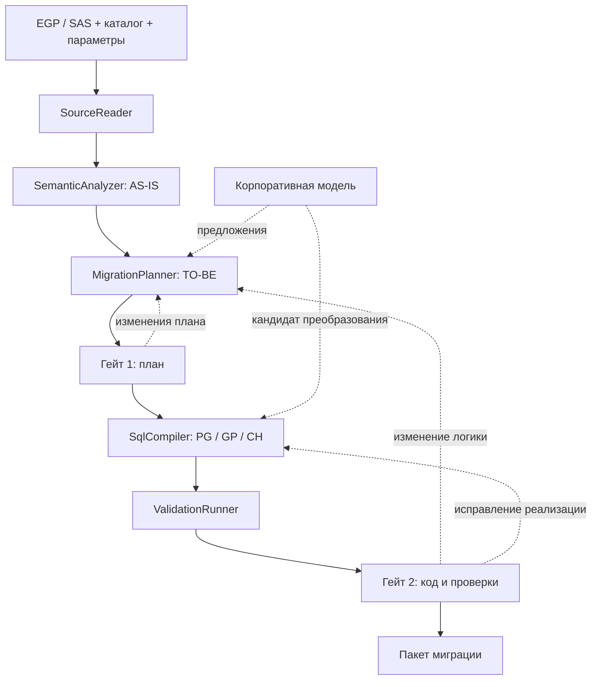

# Архитектура SAS → SQL ETL Migration

Версия проекта решения: 0.1. Дата: 9 октября 2026 года.

**Статус: proposed.** Документ задаёт архитектуру для реализации, не объявляет её уже реализованной или согласованной пользователем. Фактическая готовность описана в [README](README.md).

Обновление реализации, 10 октября: появился локальный MVP (FastAPI, React, SQLite, рендеринг SQL-кандидатов, ревизии и гейты черновика). Полная архитектура ниже остаётся целевой. Отличия MVP: JSX без TypeScript, последовательность задач вместо доказанного DAG, синхронные локальные операции вместо durable worker, ограниченный AST-разбор вместо SAS IR, профили рендеринга вместо полных target adapters. Гейты принимают только черновики и не выставляют `ACCEPTED` исполняемой миграции. [Покрытие и ограничения](README.md), [план evals](EVALS.md).

Обновление 12 октября: реализованы ограниченная IR SQL-операций, редактор логики, предпросмотр, детерминированные правила и quality gates. ИИ/API отключены по прямому запросу пользователя; разделы об LLM ниже описывают только возможное будущее развитие. Текущие контракты: [CONVERSION_RULES.md](CONVERSION_RULES.md), [QUALITY_METHOD.md](QUALITY_METHOD.md). Произвольная перестройка DAG, макроинтерпретатор и runtime validation остаются будущими этапами.

Обновление 13 октября: структурное дерево SAS-блоков с source spans и вложенными макросами, атомарный DATA/SET/WHERE/KEEP, правила построчной статистики. [Карта документации и границ поддержки](SAS_DOCUMENTATION_MAP.md). Полный macro parser, PDV и runtime validation не реализованы.

## 1. Контракт продукта

Пользователь загружает `.egp` или `.sas`, выбирает целевую СУБД и её версию, проверяет восстановленный процесс и редактирует план переноса. После первого согласования система собирает SQL, выполняет доступные проверки и представляет результат на второе согласование.

| Вход | Требование |
|---|---|
| `.egp` | Проект, встроенные программы, параметры, списки запуска и ссылки; неполный комплект допускается с явными блокировками |
| `.sas` | Одна программа; внешние зависимости и параметры обнаруживаются и запрашиваются отдельно |
| Дополнительные `.sas` и метаданные | Подключаются пользователем с явным сопоставлением ссылок; автоматический обход дисков и сетевых путей исключён |
| Каталог источников | Типы, длины, библиотеки, схемы, таблицы, форматы, ключи и доказательства их уникальности; выгрузка каталога или отдельное разрешённое подключение |
| TargetProfile | Одна целевая СУБД и точная версия на сборку, маппинг источников, схема назначения, правила хранения/загрузки |
| SQL-примеры | Отдельный ReferenceCorpus: стиль, шаблоны, соглашения. Эталоном результатов становятся только после подтверждения соответствия конкретному SAS-процессу |

Результат — пакет миграции: SQL по блокам, манифест зависимостей и запуска, параметры без секретов, тестовые запросы, отчёт о проверках и журнал согласований. Формат поставки: каталог или ZIP. Черновой пакет можно скачать до гейта 2, но его манифест явно содержит `draft` или `unverified`; исполняемый принятый выпуск требует выполнения условий гейта 2.

Система не обязуется переносить любой SAS, статистические процедуры, графику, OS-команды, почту и произвольную динамическую генерацию кода в чистый SQL. Они моделируются явно: требуемая замена в оркестраторе, ручная реализация или блокировка. Полный перенос ETL может включать SQL и конфигурацию запуска, а не только один SQL-файл.

Продукт действует внутри инфраструктуры компании. Модель доступна через корпоративный endpoint. Разбор и генерация поддержанных конструкций работают без модели. Производственная публикация/запуск ETL не являются действием кнопки согласования и не входят в первый MVP.

## 2. Принятые проектные решения

1. Детерминированное ядро: один набор исходников, метаданных, параметров, правил и целевой версии даёт одинаковый результат. Внешние факторы входят в снимки входов.
2. Исходная модель AS-IS неизменяема; целевой план TO-BE редактируется версионно. Изменение бизнес-правила отдельно маркируется как изменение требований, а не эквивалентный перенос.
3. LLM предлагает изменения модели/плана или кандидаты правил. Она не утверждает гейты, не меняет статус проверки и не выполняет SQL.
4. Два гейта принадлежат приложению. Langflow, если подключён, не становится источником истины для согласований.
5. PostgreSQL, Greenplum и ClickHouse — три адаптера общего интерфейса. Общий логический план не означает одинаковый физический план или полную совместимость.
6. Первый сквозной перенос реализуется для Greenplum: предоставленный SQL-корпус задаёт реальные соглашения этой СУБД. Две другие СУБД заложены в модель с первого дня, их реализация проходит отдельную приёмку.
7. Реальные примеры — основа инвентаризации и регрессионных проверок. Они не считаются парой «исходник — подтверждённый эквивалент», пока такое соответствие не установлено.

## 3. Поток и модули



Интерфейсы ниже — проектные контракты, пока не код. Модуль скрывает сложность за небольшим интерфейсом; сторонние зависимости передаются ему явно.

| Модуль | Интерфейс | Инвариант / результат ошибки |
|---|---|---|
| SourceReader | `read(SourceBundle) -> SourceSnapshot` | Не выполняет код; возвращает источники с происхождением и диагностику. Опасный/нечитаемый архив отклоняет |
| SemanticAnalyzer | `analyze(snapshot, catalog, bindings) -> AnalysisResult` | Возвращает AS-IS и явные неизвестные операции. Ни один исполняемый фрагмент не исчезает |
| MigrationPlanner | `propose(analysis, target)`, `revise(plan, changes, expected_revision)` | Все изменения проходят одинаковые проверки независимо от автора; конфликт версии не перезаписывает чужую правку |
| SqlCompiler | `compile(approved_plan, rule_pack) -> BuildResult` | Затрагиваемый блок без доказанных предпосылок не получает статус executable; возвращает source map и контракт результата |
| TargetAdapter | `assess(plan, catalog)`, `lower(plan) -> TargetProgram` | Три реальных реализации для диалектов; ни одна не подставляется вместо неподдержанной СУБД |
| ValidationRunner | `validate(build, validation_contract, environment) -> EvidenceSet` | Проверяет именно этот build; сохраняет snapshots и результаты, а не общую надпись «тесты прошли» |
| ReviewWorkflow | `decide(gate, revision, decision, actor)` | Атомарно проверяет ревизию, блокировки и полномочия; хранит решение как неизменяемую запись |
| ModelAdvisor | `suggest(context, allowed_change_schema) -> Proposal` | Ответ недоверенный, ограничен схемой; нет доступа к секретам, БД или методам approve |
| PackageBuilder | `export(build, evidence, approvals, mode) -> Package` | Манифест фиксирует полноту, статусы и хеши; черновик не становится принятым выпуском |

UI вызывает прикладные команды; бизнес-инварианты находятся в Python-ядре. Компилятор читает утверждённый план и типизированные операции, а не заново интерпретирует сырой SAS. Архивные форматы и клиенты БД не попадают в модель предметной области.

## 4. Детерминированный разбор SAS

### 4.1 Приём исходников

Проверка формата, лимитов числа/размера участников, пути внутри архива, дубликатов, шифрования и целостности. XML без DTD/entity expansion. Чтение только нужных участников; логи/HTML-результаты не используются как источник бизнес-данных. Ссылки на файлы регистрируются, но не открываются автоматически. Полные исходники хранятся в закрытом runtime-хранилище, отдельно от репозитория и выходного пакета.

Для EGP выбирается запуск: сохранённый OrderedList или явно составленная последовательность. Потоки `Main`/`Archive` и подписи сами по себе не доказывают, что узел выполняется. Поддержка версии EGP проверяется по версии формата и реальным fixtures; неизвестные типы узлов остаются диагностикой.

Кодировка фиксируется для каждого источника. Изменение исходного текста, кодировки или связанного внешнего файла создаёт новый SourceSnapshot. Для `.sas` создаётся один исходный узел, а порядок `%include` и внешние ссылки анализируются отдельно.

### 4.2 Лексика и макросы

Лексер понимает комментарии, кавычки, SAS name literals, границы statements, `DATALINES/CARDS`, SQL-вставки и макровызовы. Регулярные выражения допустимы для начальной инвентаризации, но не заменяют семантический парсер.

Ограниченный макроинтерпретатор поддерживает только перечисленные формы: заданные `%let`, ограниченные циклы по известному списку, подстановки и явно реализованные функции. Рекурсия, число шагов и размер результата ограничены. Он не вызывает SAS и не исполняет произвольные функции.

`%sysfunc(exist(...))` не угадывается: результат берётся из версионированного каталога либо представляется условным узлом с обеими ветвями. Режим фиксированного запуска связывает значения до гейта 1. Режим переиспользуемого процесса сохраняет допустимые параметры и предусловия, проверяемые при запуске. `today()`/`datetime()` зависят от явно заданного времени запуска и временной зоны.

Неизвестный макрос — `UnknownOperation` с диапазоном исходника и возможными побочными эффектами. Пропуск макроса с сохранением якобы полного DAG запрещён. Потенциальные зависимости неизвестного фрагмента остаются неизвестными, а не пустыми.

### 4.3 Промежуточная модель AS-IS

Модель содержит две группы операций:

- табличные: Read, Project, Filter, Join, Aggregate, Sort, Deduplicate, Union, Pivot, Write;
- зависящие от SAS-семантики: DataStepProgram, ByGroupOperation, SasMatchMerge, MacroBranch, InlineDataSource, ExternalEffect, UnknownOperation.

Не следует насильно переводить вторую группу в JOIN/CASE до проверки предпосылок.

Каждая запись таблицы создаёт `DatasetVersion`. Чтение связывается с последней доступной версией в конкретной ветви и порядке исполнения. Цикл макроса не превращается в цикл DAG: при известных границах разворачивается; иначе остаётся отдельной управляющей операцией. В точке объединения ветвей нужны совместимые контракты схемы либо явная вариативность/блокировка.

Отдельно сохраняются зависимости данных, порядка и эффектов. Удаление, публикация, commit, ошибки и внешние действия ограничивают перестановку блоков даже при отсутствии общей входной таблицы.

## 5. Модель данных и воспроизводимость

| Сущность | Обязательные поля |
|---|---|
| SourceSpan | хеш исходника, archive member/внешний файл, строки и смещения, кодировка |
| SourceSnapshot | хеш комплекта, исходные узлы, ссылки, выбранный сценарий запуска, версия reader |
| AnalysisResult | версия анализатора, операции, версии наборов данных, зависимости, неизвестные фрагменты |
| DatasetContract | schema/name, поля и типы, длины, null/missing, гранулярность, ключи с происхождением утверждения, порядок |
| Operation | тип, входные/выходные версии, SourceSpan[], выражения, эффекты, предпосылки, состояние поддержки |
| TargetProfile | диалект и версия, каталог назначения, маппинг, физические политики, режим загрузки |
| PlanRevision | parent, source/analysis/catalog hashes, параметры, blocks, mappings, decisions, validation contract |
| Proposal | базовая ревизия, ограниченный набор изменений, причина, ссылки на исходник, model/prompt metadata |
| Build | plan hash, rule-pack/compiler/adapter versions, SQL hashes, source map, контракты результатов |
| ValidationEvidence | build hash, версии сред, снимки входов, test-contract hash, executed_at, outcome, счётчики расхождений |
| Approval | gate, plan/build/evidence hashes, идентификатор утверждающего, решение, время, комментарий |

`provenance` принимает `parsed`, `rule_derived`, `model_proposed`, `human_confirmed`. Это происхождение решения, а не вероятность его правильности. Отдельно хранятся `support_status` и `validation_status`; модель не выставляет их самостоятельно.

Канонический JSON для хеширования: стабильный порядок полей, явно типизированные значения, фиксированная нормализация. Хеш исходника считается по исходным байтам. Время аудита не входит в хеш семантического плана. Версии правил и сохранённые решения ИИ обязательны: повторная сборка не обращается к модели. План, каталог, build и evidence неизменяемы; правка создаёт следующую ревизию.

### Пример контракта операции — синтетический

```json
{
  "id": "op_17",
  "kind": "ByGroupOperation",
  "inputs": ["employees_v2"],
  "outputs": ["employees_latest_v1"],
  "group_by": ["employee_id"],
  "order_by": [{"field": "changed_at", "direction": "asc"}],
  "selection": "last",
  "tie_policy": "unresolved",
  "support_status": "blocked",
  "provenance": "parsed"
}
```

Это иллюстрация формата, не извлечённый объект из реального EGP. Генерация `ROW_NUMBER()` блокируется до определения эквивалентного порядка при равных значениях. Выбор произвольного tie-breaker меняет поведение и требует отдельного решения.

## 6. Гейт 1: согласование целевого плана

Первый экран после загрузки: состав проекта, сценарии запуска, отсутствующие источники, параметры, целевая СУБД и версия. Затем рабочий экран: слева неизменяемый AS-IS, в центре целевые блоки, справа свойства и вопросы. На первом этапе допустима редактируемая таблица блоков; визуальная схема добавляется поверх тех же команд.

Карточка блока: назначение; исходные строки; входы/выходы; операции; порядок; способ материализации; условия; побочные эффекты; предлагаемое правило переноса; нерешённые вопросы; тесты.

Поддержанные команды: RenameBlock, SplitBlock, MergeBlocks, SetMaterialization, MapSource, SetTargetPolicy, BindParameter, ResolveAssumption, ReplaceOperation. Rename/перемещение карточки на экране не меняют исполнение. Reorder допустим только после проверки зависимостей. Split/Merge не удаляют исходные операции и не обходят барьеры эффектов. Удаление исполняемой логики — изменение требований с явным обоснованием и новым контрактом проверки.

Ручные действия и запросы к ИИ используют одни команды. ИИ получает разрешённую схему Proposal, человек видит diff. Python проверяет ссылки, типы, полномочия и `expected_revision`; произвольный JSON Patch к статусам/согласованиям не принимается.

Перед подтверждением выполняется детерминированная оценка реализуемости выбранным адаптером. Гейт 1 фиксирует состав переноса, маппинг, параметры, целевые политики, решения по неоднозначностям, критерии сравнения и режим validation. Неизвестная семантика обязательного блока или неизвестный критический источник запрещают executable-путь; сохранить проект плана можно всегда. Блок с понятной семантикой, но без готового правила, может пройти гейт 1 как `manual_candidate` с утверждённым контрактом реализации и тестами; исполняемый выпуск остаётся заблокирован до их выполнения. Частичная миграция допустима только с явно утверждённым составом, внешними входами и исключениями в манифесте.

## 7. Компиляция и различия трёх СУБД

Правило преобразования содержит: распознаваемую семантику, проверяемые предусловия, результат, ограничения по версиям, проверки эквивалентности и идентификатор версии. SQLGlot можно использовать внутри адаптеров для SQL AST/рендеринга с ошибкой на unsupported, но не как SAS-парсер или доказательство эквивалентности.

| Область | PostgreSQL | Greenplum | ClickHouse |
|---|---|---|---|
| Логические операции | Версионный набор правил | Общая часть с PG + независимая проверка возможностей | Отдельное понижение выражений и операций |
| Физический план | Материализация, индексы, партиции по нагрузке | Распределение, перекос, хранение/сжатие, статистика | Engine, ORDER BY, партиции, схема версий/загрузки |
| Промежуточные результаты | Время жизни и транзакционный контекст | Время жизни + политика распределения | Отдельная согласованная стратегия стадий |
| Изменения данных | Правила update/delete и транзакций | Проверка версии и ограничений распределённого исполнения | Проверка возможностей версии; стратегия перезаписи/версий/изменений выбирается явно |
| Публикация результата | Утверждённый контракт замены/инкремента | То же с учётом распределения и статистики | Свой контракт видимости результата, без переноса предположений PG |

Таблица задаёт ответственность адаптеров, а не обещает поддержку любой операции любой версией СУБД. У `TargetProfile` нет значения «последняя версия». До получения версий профили остаются неподтверждёнными.

В Greenplum-корпусе распределение и хранение уже заданы. Их можно использовать как корпоративные шаблоны, но выбор нового ключа распределения требует сведений об объёмах, кардинальности и типовых соединениях. Отсутствующие сведения отображаются как нерешённая настройка.

### Семантические правила первого покрытия

- PROC SQL: SELECT/JOIN/WHERE/агрегации/CASE/UNION; отдельно `CALCULATED`, автоматические преобразования типов, SAS missing и возможное remerge агрегатов.
- DATA STEP: последовательные присваивания и условия, KEEP/DROP/RENAME, SET с выравниванием схем. Последовательные присваивания нельзя автоматически превращать в независимые SELECT-выражения.
- BY/FIRST/LAST: полный префикс BY-группы, сортировка, пропуски и разрешение равенств. Сортировка в предыдущем шаге не гарантирует порядок строк SQL-таблицы.
- MERGE BY: отдельная SasMatchMerge-семантика, количество записей в группах, IN-флаги, пересекающиеся колонки и сохранение значений. JOIN используется только при доказанных предпосылках.
- TRANSPOSE: полный домен ID, имена и порядок колонок, дубликаты ID, типы значений. Для динамического домена нужен контракт/снимок или блокировка.
- PROC SORT: отличать NODUP/NODUPRECS от NODUPKEY; сохранять правило выбора записи и порядок сравнения.
- Функции: DATEPART, INTNX, PUT/INPUT, COMPRESS и строковые операции с типами, форматами, длинами и календарной семантикой. Неизвестный пользовательский format — внешний источник метаданных.
- Встроенные DATALINES: это данные, а не исполняемые statements. В tracked fixtures и отчёты их строки не попадают; способ переноса справочника задаётся отдельно.
- `%quitrun`: отделить расчёт от политики ошибок. Остановка процесса отражается в контракте запуска; почтовое уведомление — отдельный требуемый эффект, который нельзя молча потерять.

При отсутствии правила ModelAdvisor может предложить реализацию. Она становится кандидатом: статическая проверка, тесты семантики, экспертное решение. Принятое разовое решение фиксируется как ручной блок с контрактом и source map; общим правилом оно становится только после отдельной регрессии. Непрозрачный SQL-блок не считается автоматически доказанным эквивалентом.

## 8. Проверки и гейт 2

Статусы проверки разделены: `not_run`, `static_passed`, `execution_passed`, `comparison_passed`, `failed`, `inconclusive`. Статическая проверка не повышает статус до comparison. Подтверждение человеком не переписывает фактический статус тестов.

1. Статика: целостность плана и source map, поддержка операций, типы, AST, имена, зависимости, отсутствие неразрешённых макросов/источников, сопоставление всех обязательных результатов.
2. Проверка целевой СУБД: version/capabilities, компиляция и план запроса там, где применимо. EXPLAIN не является безопасным универсальным валидатором произвольного SQL; EXPLAIN ANALYZE и SQL с эффектами исполняются только в предусмотренной тестовой среде.
3. Исполнение: отдельные тестовые схемы/БД, ограничения времени и ресурсов, фиксированные параметры, явно разрешённые источники и операции. Reader и ModelAdvisor не имеют execution-доступа.
4. Сравнение SAS/SQL на одном снимке входов: схемы и типы, количество строк, ключи, дубликаты, значения и промежуточные контрольные точки. Сохраняются кратности строк; один checksum или сумма не достаточны.
5. Граничные случаи: пустые входы, дубликаты BY, равные ключи сортировки, missing/null/пустая строка, даты на границах периодов, отсутствующая месячная таблица, повторный запуск, сбой на публикации.

Сравнение использует нормализацию типов, явное соответствие SAS missing, согласованные абсолютные/относительные допуски и временную зону. Строки без ключа сравниваются как мультимножество. Агрегаты и хеши ускоряют поиск различий, но при необходимости проводится точное сравнение. Различие снимков входов или недоказанный порядок дают `inconclusive`, а не success.

SAS baseline получают одним из двух способов: пользователь выполняет утверждённый контрольный запуск в корпоративном SAS и передаёт манифест/результаты в закрытую validation-среду; либо позже подключается отдельный SAS runner. SAS runtime не нужен для загрузки, планирования и генерации. Сравнение с неизвестным запуском, устаревшими логами или неподтверждённым SQL-корпусом не считается проверкой эквивалентности.

На гейте 2 доступны код по блокам, исходные строки, отличие от плана, версии правил, результаты проверок и ограничения. Решение approve привязано к build+evidence+validation-contract hashes. Код нельзя изменить «под» уже принятым решением.

Для принятого исполняемого пакета обязательны comparison-проверки по согласованному контракту, отсутствие критических блокировок и решение эксперта. Если baseline недоступен, допускается только согласование черновика кода с пометкой `unverified`; это не принятый перенос процесса. Промышленный запуск остаётся отдельным действием.

### Переходы состояния

```text
IMPORTED → ANALYZED_PARTIAL / PLAN_DRAFT
PLAN_DRAFT → PLAN_READY → PLAN_APPROVED [gate 1]
PLAN_APPROVED → GENERATED / GENERATION_BLOCKED
GENERATED → VALIDATING → REVIEW_READY / VALIDATION_FAILED / INCONCLUSIVE
REVIEW_READY → ACCEPTED [gate 2] → EXPORT
```

Из каждого этапа допускается новая ревизия плана. Отклонение gate 1 возвращает PLAN_DRAFT; отклонение gate 2 возвращает код на переработку либо план на gate 1, в зависимости от изменения.

| Что изменилось | Что становится устаревшим |
|---|---|
| Исходники, сценарий, каталог, семантический параметр, маппинг, target version | Анализ/план по зависимости; gate 1, build, evidence, gate 2 |
| Утверждённая логика или контракт результатов | Gate 1 и всё после него |
| SQL/правило компиляции без изменения семантического плана | Build, evidence и gate 2; при нарушении плана также gate 1 |
| Снимок данных/validation-среда | Evidence и gate 2 |
| Расположение карточек или поясняющая подпись | Только presentation revision; согласования логики сохраняются |

## 9. Реализация и стек

Начальная форма — модульный монолит с одним worker. Микросервисы, несколько агентов, отдельная векторная БД и распределённая очередь для первого этапа не нужны.

| Часть | Выбор и причина |
|---|---|
| Ядро | Python 3.11+; чистые доменные структуры и детерминированные преобразования |
| HTTP interface | FastAPI; типизированные команды, схемы запросов и единая валидация |
| UI | React + TypeScript; формы/таблица плана, позже React Flow для схемы и редактор SQL. Node нужен для сборки UI |
| Состояние пилота | SQLite на локальном несинхронизируемом диске; транзакции, immutable revisions, optimistic concurrency |
| Корпоративное развёртывание | PostgreSQL для состояния приложения при переходе к совместной работе; отдельная БД от переносимых данных |
| Фоновые задачи | Один отдельный Python worker, задания/leases в БД приложения, сохранение результатов перед сменой состояния |
| SQL | Собственные правила семантики и три адаптера; SQLGlot как вспомогательный AST-инструмент после проверки покрытия |
| Модель | ModelAdvisor с конфигурацией endpoint/model/timeouts; OpenAI-compatible клиент только если корпоративный API действительно совместим |
| Langflow | Необязательная реализация ModelAdvisor для экспериментов; приложение сохраняет финальные proposals и решения |

Версии зависимостей фиксируются при первом исполняемом срезе в отдельном окружении этого каталога, без изменения root pyproject. Текущий inventory использует только стандартную библиотеку Python и установленный 7-Zip.

Worker получает задание с ключом идемпотентности: тип задачи + hashes входов + версия implementation. После сбоя парсинг/генерацию можно повторить. Задания с внешними эффектами требуют сверки фактического состояния; их нельзя безусловно повторять по истёкшему lease. Отмена и таймауты сохраняются как явные состояния. Перезапуск приложения восстанавливает ожидающие гейты из БД, без повторной генерации.

Минимальные ресурсы HTTP: source snapshots, analyses, plan revisions/commands, model proposals, builds, validation jobs, gate decisions и exports. Клиент передаёт expected revision; сервер возвращает conflict при устаревшей форме. UI не может напрямую менять status. При работе нескольких пользователей нужны корпоративная аутентификация и роли editor/reviewer/operator; локальный пилот слушает только loopback.

Предлагаемая будущая структура:

```text
sas_sql_migration/
  src/sas_sql_migration/
    domain/       # AS-IS, plans, contracts, transitions
    intake/       # EGP and SAS readers
    analysis/     # lexer, bounded macros, semantics, dependencies
    planning/     # proposals, edits, feasibility
    compilation/  # rules and PostgreSQL/Greenplum/ClickHouse adapters
    validation/   # execution and comparison
    application/  # workflows and jobs
    infrastructure/ # storage, internal model client, DB clients
    api/
  frontend/
  tests/
  tools/
  evidence/
```

Это план структуры, пустые runtime-модули сейчас не создаются.

## 10. Данные, модели и эксплуатационные ограничения

Архив может содержать секреты в коде и персональные данные в логах/результатах. Intake сохраняет исходники только в закрытом хранилище; логи и ODS по умолчанию не импортирует. До model request код и метаданные проходят отбор и удаление значений секретов. Полные исходники автоматически не посылаются даже внутренней модели. Разрешённые endpoints фиксируются конфигурацией; облачный fallback отсутствует. Ключи берутся из корпоративного secret store/локального защищённого механизма, не из плана, промпта или пакета.

Комментарии и инструкции внутри исходников остаются текстом анализируемой программы. ModelAdvisor получает только необходимые фрагменты, типы и разрешённые операции изменения; текст ответа проходит структурную и семантическую проверку.

Validation может читать строки в закрытой тестовой среде, но не отправляет их модели и не сохраняет в репозитории или отчёте. Отчёт содержит агрегированные результаты и идентификаторы проверок; детальное исследование различий остаётся в тестовой среде с её политикой хранения. Встроенные справочники и константы бизнес-логики переносятся по отдельной политике, а не маскируются как неизвестные операции.

Аудит содержит hashes/revisions, решения и коды ошибок; секреты, полные запросы с чувствительными литералами и строки данных туда не попадают. Метрики качества: доля операций с проверенными правилами, доля блокировок, время ручного исправления, результаты сравнений и время выполнения. Количество агентов и оценка уверенности LLM не являются метрикой корректности.

## 11. Неизвестные параметры, не блокирующие проектирование

- Точные версии PostgreSQL/Greenplum/ClickHouse и разрешённые способы тестового исполнения.
- Протокол корпоративного model endpoint, модели, лимиты контекста и качество структурированных ответов.
- Маппинг SAS-библиотек на целевые схемы, каталоги форматов, фактические параметры запусков.
- Контрольные SAS-запуски и снимки данных для сравнительных тестов.
- Соответствие SQL-корпуса данному EGP не подтверждено.
- Допустимость загрузки внешних справочников, правила публикации и политика ошибок/уведомлений.

До уточнения этих параметров можно реализовывать intake, AS-IS, редактор планов и статические проверки. Нельзя объявлять принятую миграцию или выбирать неизвестные значения за пользователя.

## 12. Первичные источники

Проверены 9 октября 2026 года. Примеры пользователя изучались локально; их содержимое не отправлялось в веб-поиск.

- [SAS Enterprise Guide: встроенные и внешние программы](https://support.sas.com/documentation/onlinedoc/guide/sasegforprogrammers.htm).
- [SAS: FIRST./LAST. и BY-группы](https://support.sas.com/documentation/cdl/en/lrcon/62955/HTML/default/a000761931.htm).
- [SAS: отличие many-to-many MERGE](https://support.sas.com/kb/24/752.html).
- [SQLGlot: возможности, диалекты и обработка unsupported](https://github.com/tobymao/sqlglot/blob/main/README.md).
- [FastAPI](https://fastapi.tiangolo.com/), [React Flow](https://reactflow.dev/learn).
- [Langflow HITL](https://docs.langflow.org/human-in-the-loop): наличие в документации не подтверждает доступность в установленной корпоративной версии.

Состав и порядок модулей, контракты гейтов и план реализации — проектные решения этого документа, а не утверждения из документации поставщиков.
