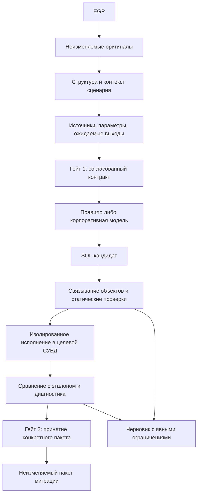

# План разработки нового ядра и разбор проблемных мест

Дата: 31 октября 2026 года. Статус: проект реализации после ревью текущего кода и накопленных экспериментов. Работы ниже ещё не выполнены. Подключения к корпоративной модели, SAS и целевым СУБД в этом ревью не выполнялись.

Документ уточняет [план P0-P9](API_SERVICE_IMPLEMENTATION_PLAN.md), [архитектуру корпоративного API](API_ARCHITECTURE_UPDATE_20261028.md) и [контракт замены источников](SOURCE_BINDINGS_UX_SPEC.md). Сохраняет их направление. При реализации использовать этот документ как актуальную последовательность работ, прежние документы - как подробные требования. Архитектуры PBIX и Data Compass не затрагиваются.

## 1. Решение и главный риск

Разрабатывать новое ядро рядом с нынешним MVP, переиспользуя UI, импорт EGP, отдельные правила и упаковку Windows. Прямой корпоративный API получает роль генератора кандидатов. Приложение сохраняет исходники, задаёт ограничения, проверяет результат и управляет двумя согласованиями. Langflow не нужен для рабочего исполнения; его можно оставить для отдельных экспериментов.

Главный риск - получить убедительный SQL для неправильно восстановленного SAS-процесса. Даже сильная модель не исправит молча потерянный участок исходника, неверный порядок программ, отсутствующее определение макроса или подменённый источник. Поэтому первая инвестиция - достоверный вход и проверяемый контракт целой цепочки.

Вторая опасность - потратить весь срок на универсальный компилятор SAS. Полная SAS IR не требуется до первого вызова модели. Требуются сохранный исходник, известные и неизвестные зависимости, достаточный контекст и независимо согласованные ожидаемые результаты. Непонятный фрагмент можно передать модели для предложения, но нельзя считать автоматически проверенным.

Критерий результата остаётся прежним: согласованные сценарии пользовательских EGP корректно работают на целевой СУБД и сохраняют ожидаемые результаты. Блокировки полезны для диагностики, но заблокированный файл не считается успешно перенесённым.

## 2. Что фактически есть

| Основание | Проверенный факт | Следствие |
|---|---|---|
| `app/core.py`, `make_block`, строки 122-140 | В анализ и генерацию передаётся `public_source(source)` | Новое ядро обязано читать отдельный оригинал; косметическая правка генератора недостаточна |
| `app/server.py`, `Store.command` | `transition` выполняется внутри SQLite-транзакции | Будущий HTTP-вызов модели и исполнение БД нельзя добавлять внутрь этой операции |
| `app/server.py`, `model_config` | `available=False` | Реальная совместимость корпоративного API и качество модели ещё не проверены |
| `app/local_network.py` | Упакованный MVP допускает только loopback | Для корпоративного API нужна отдельная политика разрешённых адресов, а не отключение ограничителя целиком |
| `releases/release-validation.json` | Сохранён успешный отчёт запуска EXE без Python/Node в PATH, на синтетическом EGP; `sql_equivalence=not_tested` | Упаковку можно переиспользовать, семантическую готовность она не подтверждает |
| `experiments/quality_first/results/report.md` | Синтетическая проверка: синтаксис пропустил 22 из 22 ошибочных кандидатов; расширенные известные контрпримеры выявили все 22 | Нужны проверки результатов; это не оценка реальной модели и не результат на независимой выборке |
| `acceptance/corpus_manifest.json`, предыдущие отчёты | Четыре EGP, 49 программных узлов, 48 доступных исходников; отсутствует внешний исходник 541 | Перепроверить при новом импорте; модель не должна сочинять отсутствующую программу |
| Git на дату ревью | Папка SAS не отслеживается родительским Git; есть посторонние изменения | Новая ветка сама по себе не сохранит приложение. Нужен проверенный исходный снимок |

В этой работе прочитан актуальный код и сохранённые отчёты. Корпус EGP и runtime-тесты заново не прогонялись. Показатели предыдущих экспериментов не обозначают текущее покрытие конвертера.

## 3. Рабочая схема приложения

В первой поставке это одно локальное приложение: EXE запускает backend и локальный интерфейс в браузере. Новое хранилище находится в `%LOCALAPPDATA%\SasSqlMigrationV2`, вне папки синхронизации. Старое приложение и его БД остаются отдельными. Не вводим микросервисы, Redis, обязательный Docker или отдельный сервер Langflow.

Логические модули нового пакета `migration_v2/`:

| Модуль | Малый внешний интерфейс | Что скрывает внутри |
|---|---|---|
| `sources` | `ingest(archive) -> SourceSnapshot` | Проверки архива, кодировки, оригиналы, внешние ссылки, координаты |
| `context` | `prepare(snapshot, scenario, inputs) -> TaskDraft` | Структуру SAS, макросы, версии таблиц, метаданные, назначения источников, неизвестности |
| `generation` | `propose(approved_task, feedback) -> Candidate` | Выбор проверенного правила либо корпоративной модели, подготовку и контроль размера запроса |
| `verification` | `verify(task, candidate, level) -> EvidenceSet` | Связывание SQL, проверки допустимых действий, целевое исполнение и сравнение |
| `workflow` | `apply(command, expected_revision) -> Revision/Job` | Состояния, задания, отмену, повтор, гейты, сборку и экспорт |
| `infrastructure` | Реализации интерфейсов хранения, транспорта и исполнения | SQLite, файлы, корпоративный HTTP, секреты, драйвер конкретной СУБД |

Это модули внутри одного приложения. Не создавать отдельный класс и слой на каждое действие. Не переносить внутрь них весь `core.py` без разделения ответственности. Старые правила подключаются как генератор и проходят те же проверки, что модель.

## 4. Проблемы, которые меняют план

| Приоритет | Проблемное место | Решение | Проверка решения |
|---|---|---|---|
| P0 | Анализ по проекции для экрана теряет данные и участки программы | Оригинал, отображение и контекст модели - разные артефакты; анализ читает оригинал | Побайтовое восстановление доступных исходников, включая хвост после ошибки и inline-ресурсы |
| P0 | Контракт результата может быть столь же ошибочным, как SQL | Для пилота контракт входов, выходов и контрольных точек проверяет владелец процесса по исходнику | Модель не имеет права уменьшать обязательные выходы или менять критерии сравнения |
| P0 | Неизвестные зависимости превращают красивый DAG в догадку | Неизвестный эффект - отдельное состояние, а не пустое множество чтений/записей | Неизвестный производитель не позволяет принять зависимый выход; независимость должна иметь основание |
| P0 | Замена источника меняет данные, а не только адрес | Проверять контракт полей, ключей, гранулярности и покрытия нового источника | Разделить результат проверки перевода и результат проверки перехода на новый источник |
| P0 | Нет эталонов и тестового GP | Разрабатывать локальный контур, но получать эталоны и стенд параллельно с первого этапа | Статусы `not_run`/`unavailable` не превращаются в `passed` |
| P0 | Динамический макрос нельзя корректно заменить константой из одного запуска | Разделить фиксированный запуск и повторяемый процесс | Повторить пакет с другим периодом и данными без новой генерации моделью |
| P0 | Синтаксически допустимый SQL может иметь неожиданные эффекты | Проверка AST, разрешённых функций/действий и отдельная роль БД с ограниченными правами | Нельзя обратиться к чужой схеме, выполнить внешний вызов либо произвольный код |
| P1 | Маленькие куски теряют состояние; целый проект не входит в контекст | Делить по семантическим единицам с контрактами входов/выходов | Все фактические зависимости включены или явно отмечены; никакого тихого усечения |
| P1 | Два кандидата используют разные версии промежуточной таблицы | Версионировать логические объекты на каждой записи | Повторное создание таблицы внутри одного PROC и между программами связывает нужных потребителей |
| P1 | Поздний ответ модели заменяет новый проект | Неизменяемые задания и проверка ревизии при применении | Ответ старого задания сохраняется в истории, но не становится текущим |
| P1 | EXE проходит локально, но блокируется корпоративной средой | Ранний запуск минимального нового EXE на целевом ноутбуке | Проверить proxy/CA, endpoint, EDR, временный каталог, браузер и перезапуск |
| P1 | Проверки и промпты подстраиваются под одни примеры | Отдельные разработческие и закрытые контрольные сценарии | После выбора кандидата проверять контрольный набор без дальнейшей подгонки на нём |

### 4.1. Как ограничить сложность SAS-разбора

Сохраняем три независимых результата: структурное покрытие текста, восстановленную семантику и проверенность SQL. Структурно найденный PROC не означает, что разобраны все его операции.

Для каждого участка сохраняются происхождение, диапазон, исходный текст и статус: известная конструкция, неизвестная конструкция, декларация, данные либо комментарий. Промежутки между найденными секциями остаются в реестре. `RUN`, `QUIT`, `PROC SQL` исчезают из целевого SQL только как синтаксические границы разобранного узла. Глобальный поиск и удаление этих слов недопустимы: они могут встретиться в строках, комментариях и другом контексте.

Официальное языковое ядро SAS использовать через адаптер для структуры. Это не готовый семантический компилятор. Его испытанный патч и координаты UTF-16/Unicode/байты входят в приёмку адаптера. Если добавляем Node-runtime для этого ядра, он должен поставляться внутри приложения; установка Node пользователем не становится условием работы EXE. Неиспользуемые OSS-репозитории остаются в комплекте разработки, а не загружаются при запуске.

Не ставить поддержку каждого слова SAS в предварительное условие пилота. Новые конструкции добавлять по реально обнаруженным полным цепочкам и по минимальному примеру ошибки. Опасные неизвестные эффекты требуют уточнения, даже если модель предложила правдоподобное объяснение.

### 4.2. Макросы, IF, форматы и данные

| Семейство | Что обязано попасть в контекст | Как действовать |
|---|---|---|
| `%MACRO`, `%LET`, вызовы, области видимости | Определения, порядок переопределений, аргументы, видимые значения | Раскрывать только поддержанные формы с известными условиями; сохранять исходный и раскрытый варианты с происхождением |
| `%IF`, циклы и динамические имена | Момент вычисления, ветви, допустимые параметры и состав объектов | Неизвестную ветвь сохранять. Не объявлять её неисполняемой на основании одного примера |
| `SELECT INTO`, `CALL SYMPUT/SYMPUTX` | Производитель значения, тип, порядок, пустой/множественный результат | Переносить вычисление при запуске; явно определить поведение при нуле и нескольких строках |
| DATA STEP IF/ELSE, присваивания, OUTPUT | Последовательность операций, состояние переменных и число выходных записей | Генерировать целый DATA STEP либо доказанно отделимую группу; не переводить строки независимо |
| RETAIN, BY, FIRST/LAST, MERGE, LAG | Порядок, дубли, сохранённое состояние, условия вызова | Использовать отдельные правила с предусловиями; при отсутствии порядка не выдумывать стабильный ключ |
| FORMAT/INFORMAT, PUT/INPUT | Определение формата, входной/выходной тип, длина, правила отсутствующих и неизвестных значений | Различать отображение, разбор и бизнес-классификацию; проверять ведущие нули, границы и неизвестные коды |
| DATALINES/CARDS и внешние файлы | Схема, кодировка, локальный ресурс и правила чтения | Данные сохраняются как вход миграции. Если не передаются модели, локальный загрузчик всё равно обязан их перенести |
| LIBNAME | Явно предоставленные пользователем связи | Автоматический resolver остаётся отложенным; UI назначения источников реализуется независимо |

Для каждой конкретной реализации нужны ссылка на соответствующее правило SAS, применимые версии/опции, предусловия и содержательные проверки. Эта таблица задаёт объём анализа, а не подтверждает поддержку перечисленных конструкций.

### 4.3. Два вида результата, которые нельзя обещать одновременно молча

Первый режим - SQL для фиксированного сценария и согласованных параметров. Его запускают в DBeaver на конкретной целевой СУБД. Фиксация параметров видна в манифесте; такой файл нельзя выдавать за универсальный ежедневный ETL.

Второй режим - повторяемый процесс. Динамика должна выражаться поддержанным SQL целевой СУБД либо ограниченным декларативным планом: выполнить SQL, получить типизированное значение, выбрать ветку, пройти ограниченный список, загрузить локальный ресурс. Модель не генерирует исполняемый Python для такого runner. Произвольный SQL внутри строк не получает автоматического допуска.

Для первого пилота выбрать режим по фактической цепочке 348. Если нужен runner, зафиксировать это до гейта 1 и показывать пользователю состав пакета. Полная приёмка файла с динамикой требует повторяемого режима; один удачный фиксированный запуск этого не заменяет. Обе стратегии остаются в одном контракте артефактов, но runner не разрабатывается заранее без подтверждённой необходимости.

### 4.4. Замена источников - отдельная проверка смысла

Backend хранит `SourceBinding`, модель его не редактирует. Идентичность включает исходную систему, область сценария и версию объекта. Подстановка делается по связанным объектам SQL AST, а не заменой текста. Промежуточные версии и явные назначения записи защищены от переименования входа.

Подтверждение имени не доказывает, что новая таблица эквивалентна старой. У неё могут отличаться единица записи, период истории, дубли и бизнес-фильтры. Если поля отличаются, отдельный проверенный адаптер источника должен сформировать согласованную входную схему. Модель не сочиняет отсутствующие поля.

При замене источника различаем два эксперимента:

1. Проверка перевода: SAS и SQL получают одинаковые логические входные данные. Проверяется сохранение преобразований.
2. Проверка перехода: новая таблица/адаптер формирует согласованный вход. Проверяются полнота и смысл замены.

Если требуется намеренно изменить бизнес-логику, это отдельная версия требований с новыми ожидаемыми результатами. Её нельзя подписывать как доказанную эквивалентность старому SAS.

Правило пользователя сохраняется: выход без библиотеки или с `WORK.` - временная таблица; явная схема выхода сохраняется. Это правило относится к назначениям записи. Неразрешённое чтение `work.x` не позволяет автоматически создать пустую входную таблицу.

### 4.5. Проверки, которые действительно защищают качество

Проверяющий модуль получает критерии из согласованного контракта и независимых эталонов. Самооценка модели, её source map и тесты из того же ответа могут помогать ревью, но не являются доказательствами.

Статический анализ проверяет синтаксис, существование и разрешённость объектов, зависимости, выходы и допустимые операции. Он не доказывает эквивалентность. Даже SELECT может вызвать функцию с эффектами; разрешить только тип statement недостаточно. Для исполнения нужны ограниченные права, разрешённые функции/расширения, таймауты и изолированная область БД. `EXPLAIN ANALYZE` исполняет запрос, поэтому не используется как безвредный линтер ([PostgreSQL EXPLAIN](https://www.postgresql.org/docs/current/sql-explain.html)).

Сравнение учитывает схему, значения и кратность строк. Сортировка строк для сравнения допустима только для результата без значимого порядка. NULL, пустая строка и SAS missing не склеиваются молча. Числовые допуски задаются по полям заранее. Нельзя использовать один общий допуск или общую обрезку пробелов для всех результатов. Для больших таблиц подсчёты и хеши помогают найти участки расхождения; один совпавший агрегированный хеш не называется полным точным сравнением.

Снимки входов должны относиться к одному состоянию данных. Разница между вчерашним SAS и сегодняшним DWH не доказывает ошибку перевода. Источник эталона, параметры, время/идентификатор снимка и правила нормализации входят в отчёт.

При ошибке сначала локализовать её класс: потеря исходника, неверный mapping, недостаточный контекст, дефект SQL, различие входных данных или неверный эталон. Только дефект кандидата отправляется на автоматическое исправление. Не более двух исправлений после первого ответа; изменение контракта создаёт новое задание и возвращает гейт 1.

### 4.6. Сессии, перезапись таблиц и повтор запуска

Логическая версия таблицы отделена от физического SQL-имени. Повторные записи одной таблицы внутри PROC и между программами должны иметь явных производителей и потребителей. Планировщик выбирает временные имена и публикацию с учётом целевой СУБД, не меняя согласованные итоговые назначения.

Временные таблицы требуют сохранения сессии; в PostgreSQL их срок жизни связан с сессией и выбранным `ON COMMIT` ([CREATE TABLE](https://www.postgresql.org/docs/current/sql-createtable.html)). Это основание включить сессию в план, но не доказательство одинакового поведения всех версий GP и ClickHouse. Профиль точной версии каждой СУБД проверяется отдельно.

После падения приложения задания генерации можно безопасно повторить как получение нового кандидата. Исполнение SQL повторять вслепую нельзя: оно могло завершиться на сервере. Нужны журнал шагов, идентификатор запуска и состояние `outcome_unknown`, которое требует проверки факта исполнения. Для первого пилота достаточно одного исполнителя и полного перезапуска в новой тестовой области после подтверждённой очистки. Производственная публикация отдельно согласуется и не входит в кнопку гейта 2.

### 4.7. Корпоративная сеть и EXE

Разрешённые направления будущего приложения: localhost, настроенный корпоративный API, отдельно разрешённые внутренние подключения к тестовой СУБД. Доступ к DWH не является обязательным условием локальной генерации. Публичный fallback, внешние трассировки, CDN, скачивание зависимостей при запуске и автоматическая отправка отчётов исключаются.

API вызывается backend. Профиль фиксирует точный HTTPS endpoint, model ID, корпоративный CA/proxy при необходимости и ограничения. Редиректы на неразрешённые адреса отклоняются, ключ не пересылается на другой origin. Секрет хранится средствами Windows, не в EGP, браузере, промпте или SQLite-проекте. Логи по умолчанию содержат ID, стадии, длительности и диагностические коды; запросы/ответы с кодом хранятся отдельно в локальном защищённом проекте по согласованной политике.

Текущий Python audit hook не является полноценной изоляцией: Python прямо предупреждает, что audit hooks не подходят для sandbox ([документация Python](https://docs.python.org/3/library/sys.html#sys.addaudithook)). Надёжное ограничение исходящих соединений требует корпоративного firewall/proxy и проверки сетевых обращений всей поставки, включая возможный Node-процесс. Не выполнять недоверенный код из SAS, архива или ответа модели.

Локальный HTTP-интерфейс также нуждается в проверке Host/Origin и токене сессии приложения: сам адрес 127.0.0.1 не является авторизацией для изменения проектов. Ключ модели никогда не является этим токеном.

EXE - способ поставки, не отдельная архитектура. Оставляем текущую упаковку для пилота. Если корпоративный EDR блокирует распаковку one-file во временный каталог, используем подписанный установщик с фиксированными файлами и EXE-точкой входа; установленные Python/Node пользователю по-прежнему не нужны. Этот выбор проверить рано, до функциональной приёмки всего корпуса.

## 5. Контракты и состояния

Основные артефакты: `SourceSnapshot`, `ScenarioContract`, `SourceBindingSet`, `MigrationTask`, `Candidate`, `EvidenceSet`, `Release`. Каждый имеет версию схемы и устойчивый идентификатор. Снимки и принятые артефакты неизменяемы; редактирование создаёт новую ревизию.

Хеш задания связывает исходники, сценарий, параметры, назначения, метаданные, определения форматов, профиль СУБД и версию стратегии. Кандидат хранит хеш задания и точные полученные артефакты. Доказательства связываются с хешем собранного пакета, тестовыми данными, средой и версией проверок. Для первого выпуска при любом смысловом изменении инвалидировать весь пакет и оба гейта. Выборочное переиспользование проверок вводить позже только при доказанной независимости.

Жизненный цикл: `IMPORTED → NEEDS_CONTEXT → PLAN_READY → PLAN_APPROVED → GENERATING → CANDIDATE_READY → VERIFYING → REVIEW_READY → ACCEPTED`. Это состояния workflow, а не один показатель качества. Отдельно хранятся статусы проверок: `passed`, `failed`, `not_run`, `unavailable`, `stale`. Изменение входов возвращает процесс к подготовке контракта. Сбой, отмена и неизвестный исход исполнения имеют отдельные состояния задания.

Гейт 1 фиксирует сценарий, цель, параметры, назначения, ожидаемые выходы и план проверки. Непонятная конструкция может допускаться для получения экспериментального кандидата, если её текст и достаточный контекст сохранены. Неизвестные исходные данные или отсутствующий обязательный макрос означают предварительное исследование, а не готовый план миграции.

Гейт 2 для принятой миграции доступен после обязательных проверок полного сценария. Черновик можно скачать раньше с явным статусом. Ручное согласование не меняет `unavailable` на `passed`. Если впоследствии нужен отдельный режим экспертного принятия без эталонов, это новый явно согласованный режим с другим названием, а не обход текущей приёмки.

## 6. Последовательность разработки

Нумерация ниже сохраняет P0-P9. Подэтапы уточняют порядок и уменьшают риск долгой разработки без проверки гипотезы.

| Очередь | Этап | Результат, который можно показать | Критерий завершения | Зависимость |
|---|---|---|---|---|
| 1 | P0: изоляция и исходная фиксация | Отдельная рабочая копия нового ядра, чистый список исходников, базовый отчёт | Старое приложение и данные не изменены; посторонние изменения не перенесены | Нет |
| 2 | P1: оригиналы и полный реестр | EGP импортируется, каждый исходник и пропуск виден, текст не теряется | Доступные исходники восстанавливаются побайтово; неизвестные хвосты сохраняются | P0 |
| 3 | P2a: один сценарий 348 и mapping | Реальная панель источников, контракт полной цепочки с `vstr` | У всех входов есть происхождение; выходы, параметры, макросы и неизвестности проверены по исходнику | P1 |
| 4 | P3a: минимальный независимый проверяющий модуль | Принимает законченный синтетический кандидат, отклоняет содержательные ошибки | Выдуманный объект, лишняя запись, устаревший ответ, пропавший выход и обрезанный JSON отклоняются | P2a |
| 5 | P4a: корпоративный транспорт и новый EXE | На корпоративном ноутбуке выполняется синтетический запрос | Подтверждены endpoint, TLS/proxy, формат ответа, таймаут/отмена; нет публичных обращений | P3a, настройки API |
| 6 | P4b: живой пилот генерации | Полная цепочка 348 с зафиксированным контекстом и SQL-кандидатом | Независимое ревью содержания, явные неизвестности, не более двух исправлений | P4a, согласованный контракт |
| 7 | P3b/P5: целевое исполнение и сравнение | Пакет исполняется в GP, отчёт показывает первую расходящуюся контрольную точку | Обычный, граничный и иной параметрический запуск согласованы с эталонами | Тестовый GP, эталоны, P4b |
| 8 | P2b/P6: стабилизация и UI всего процесса | Два гейта, восстановление заданий, редактирование, история, экспорт | Пользователь проходит сценарий без ручных JSON; смена контекста делает проверки устаревшими | Стабильный пилот |
| 9 | P7: весь корпус на GP | Все обязательные сценарии 348, затем 541/RL_DB/RL_FIX | Каждый обязательный выход проверен на согласованных входах; пропуски не спрятаны | P5/P6, внешний исходник 541 |
| 10 | P8: рабочая поставка | Подписываемый EXE/установщик, пакет зависимостей, обновление и восстановление | Проверка в корпоративной среде, миграция локальной схемы хранения, сохранность проектов | P7 |
| 11 | P9: другие СУБД | PG и ClickHouse с отдельными профилями и отчётами | Повторная приёмка полного согласованного корпуса на каждой версии | Стабильный общий контур |

Подготовка GP, эталонов и параметров API начинается одновременно с P0. Нельзя отложить её до окончания интерфейса. Без этих условий P1-P3a и локальная часть адаптера полезны и выполнимы, но не заменяют P5.

Первый законченный набор работ для реализации: P0 + P1 + P2a + P3a. Его демонстрация - загрузить 348, показать сохранные исходники, назначить источники, согласовать контракт одной полной цепочки и проверить подготовленного кандидата без вызова API. Затем сразу P4/P5; не расширять предварительно parser на весь SAS.

UI-панель назначений включается уже в P2a. Ждать общего P6 для неё нельзя: от назначения зависит само задание модели. Внешний вид остального интерфейса можно сохранять до стабилизации контракта.

## 7. Эксперимент, который определяет дальнейшее решение

Выбрать одну полную цепочку 348 с `vstr`, её источниками, определениями макросов и потребителями результата. Не брать отдельный красивый SELECT. Рядом оставить второй независимый пример из другой программы как контроль переносимости подхода.

Сравнить три способа на одинаковых входах и одинаковых критериях:

1. Существующий генератор как исходный уровень, без приписывания неподдержанным операциям успеха.
2. Корпоративная модель с полным контекстом и без автоматического исправления.
3. Та же модель и контекст, но с диагностикой и максимум двумя исправлениями.

Сохранять фактический model ID, версию стратегии, запрос, ответ, число попыток и правки эксперта. Не выбирать лучший из множества ответов задним числом без учёта остальных. До принятия пилота повторить генерацию несколько раз на тех же входах для оценки нестабильности; это небольшой эксперимент, не нагрузочный тест. Контрольные данные не использовать в цикле исправлений.

Основные показатели: совпавшие обязательные выходы, пропущенные ошибочные кандидаты, ложные отказы хорошим кандидатам, доля незавершённых сценариев и объём ручной доработки. Длительность и число токенов вторичны. Длина SQL и число распознанных блоков не являются KPI корректности.

Нулевой пропуск известных мутантов обязателен для регрессионного набора, но не означает нулевого риска на новых программах. Результаты показывать по каждой семье конструкций и полному сценарию, без единого процента «уверенности».

Решение после пилота:

- Если потеряны входы/операции - чинить подготовку контекста и контракт до смены модели.
- Если контекст полон, но SQL регулярно неверен - проверить другую доступную корпоративную модель/стратегию либо реализовать конкретное правило для повторяющейся конструкции.
- Если генерация приемлема, но ошибки проходят проверку - усиливать независимый проверяющий модуль до расширения корпуса.
- Если цепочка выдерживает сравнение и повторные сценарии - расширять покрытие по P7.

## 8. Минимальные содержательные проверки

Не добавлять массовые тесты, повторяющие реализацию. Для начала достаточно следующих семейств с несколькими предметными случаями:

| Проверка | Какую прежнюю ошибку или риск ловит |
|---|---|
| Сохранность исходника, CARDS, кавычки, комментарий и ошибка в середине | Потерю хвоста программы, литерала или inline-значений |
| Макрос, неизвестный IF и зависимое вычисление | Удаление ветки и фиксацию значения из одного запуска |
| Повторная запись таблицы и последующий потребитель | Чтение не той версии данных |
| Mapping чтения при совпадении с именем выхода | Подмену назначения записи и простую строковую замену |
| Недопустимый объект/функция, обрезанный ответ, устаревший хеш | Выполнение неподтверждённого кандидата |
| Дубли, NULL, пустые строки, ведущие нули, граничная дата | Семантические потери при внешне правильном SQL |
| Сбой, отмена, повтор и поздний ответ | Перезапись ревизии либо повтор побочного эффекта |
| Полная цепочка в точной версии GP на одинаковом входе | Ошибку сборки, сессии или взаимодействия корректных по отдельности шагов |
| Запуск итогового EXE без внешних загрузок | Необъявленную runtime-зависимость и проблемы корпоративной установки |

Реальные fixtures хранятся локально с разрешённым доступом; в репозитории - манифесты и минимальные синтетические регрессии. Корпоративный код и строки данных не отправлять во внешние CI или сервисы проверки.

## 9. Прогноз и границы обещания

Новое ядро технически можно собрать на текущем стеке без полной переработки UI. Основная работа - достоверный контекст, работа с состоянием SAS, проверка результатов и жизненный цикл пакета. Сам HTTP-клиент модели будет небольшой частью реализации.

Ожидаемый выигрыш от модели - предложение перевода сложных связных фрагментов без отдельного ручного правила на каждый случай. Это гипотеза до живого пилота. Переход на API сам по себе не даёт основания обещать качество или сроки полной миграции всех файлов.

Первый срок, который стоит оценивать после начала, - завершение P0-P3a. Срок полной приёмки можно обоснованно пересчитать после P4/P5 по обнаруженным классам ошибок, ручным исправлениям и доступности эталонов. Пока нет этих измерений, обещание фиксированного числа недель создаст ложную точность.

Если эталоны и GP недоступны, достижимый результат - локальный сервис подготовки и ревью SQL-кандидатов с честными ограничениями. Полноценная миграция остаётся целью, но статус её приёмки остаётся открытым. Не расширять UI и каталог правил вместо устранения этого разрыва.

## 10. Что изменено этим ревью

Уточнён план, добавлены решения по эквивалентности при замене источника, динамическому ETL, непрерывности сессии, неизвестному исходу исполнения, независимости проверок и корпоративной поставке. Панель источников перенесена в ранний сквозной этап. Обязательный живой пилот поставлен до расширения общего parser.

Код приложения, EXE, проекты пользователя, гейты и настройки API в этой работе не менялись. Указанные критерии предназначены для будущей реализации; тесты новой архитектуры ещё не выполнялись.
